# 위드라이빙 (WithDriving)

[](https://github.com/Kyle-ChoiKH/WithDriving/actions/workflows/ci.yml)
-0E1B2B)


**차의 신호로 살아 움직이는 테마와 함께 달리는 차량용 동승 앱. 안전하게 달릴수록 내 테마가 업그레이드됩니다.**

내가 밟고, 멈추고, 깜빡이를 켤 때마다 화면 속 세계가 똑같이 반응합니다. 캐릭터 브루미가 자기 꼬마차로 따라 달리고, 시계 무브먼트와 엔진 단면이 돌아갑니다.


현대자동차그룹 차량용 앱 개발 공모전(Code your App into Pleos App Market) 출품작입니다.
Pleos Connect(AAOS 기반)에서 Pleos Connect SDK(Vehicle, NaviHelper, TextToSpeech, SpeechToText, FusedLocation)를 사용합니다.

---

## 1. 실행 방법

### 1-1. APK 설치 (가장 빠른 방법)

```
adb install -r apk/TEAMNAME_WithDriving_release.apk
```

- APK 위치: [`apk/`](apk/) 폴더. 파일명 규칙은 `팀명_앱이름_release.apk`이며, `gradle.properties`의 `vroomi.teamName` 값으로 정해집니다.
- APK가 GitHub 업로드 용량을 넘으면 GitHub Releases에 올리고, 여기에 Release 주소를 적습니다: `(Release 링크 자리)`
- 이 앱은 `android.hardware.type.automotive`를 요구하므로 **Pleos Connect Emulator(AAOS)** 나 실차에만 설치됩니다.

### 1-2. 데모 드라이브 (설치 후 바로)

1. 처음 실행하면 브루미 소개 카드가 나옵니다. **데모 드라이브 보기**를 누르면 3분짜리 하이라이트 주행이 시작됩니다.
2. 그 뒤에는 홈 화면 왼쪽 아래 **데모 드라이브** 버튼으로 언제든 다시 고를 수 있습니다.
3. 데모는 시뮬레이터 신호로 달립니다. 화면 오른쪽 위에 "깜빡이 → 꼬마차도 깜빡, 방향 표지판"처럼 **지금 어떤 신호에 반응하는지** 설명이 나옵니다.
4. 데모가 끝나면 P단에서 **오늘의 드라이브** 카드(점수·별·거리·풍경)가 뜹니다. 데모 기록은 다이어리에 "데모"로 표시되고, 우정 레벨에는 반영되지 않습니다.
5. 실제 차가 움직여 운전자 주의 제한(CarUxRestrictions)이 걸리면 데모는 바로 멈춥니다.

| 시나리오 | 길이 | 보여 주는 것 |
|---|---|---|
| `highlight` (브루미 하이라이트) | 3분 | 인사 → 꼬마차 탑승 → 부드러운 출발 → 깜빡이 → 바람 → 찬 공기 → 브레이크 → 신호 대기 → 급제동 → 비·밤 → 서리 제거 → 스포츠 → 크루즈 → 에코 → 길안내 → 도착 결승선 → 다이어리 → 작별. 별 7개, 콤보, km 표지판 2개, 풍경 3곳 |
| `commute` (출근길) | 3분 | 도시 출퇴근: 신호 대기, 좌·우 깜빡이, 에어컨 바람, 급제동, 고속도로 |
| `rainy_night` (비 오는 밤) | 2분 | 전조등과 밤하늘, 앞유리 서리 닦기, 비와 우비, 길안내 모자, 1km 전 목적지 깃발, 도착 축하 |
| `ev_charge` (EV 충전) | 1분 30초 | 배터리 15% 이하 배고픔, 충전기 케이블 연결, 에너지 먹기 |
| `family_trip` (가족 여행) | 2분 30초 | 에코 모드 초록 꼬마차, 크루즈 선글라스, 최대 냉방, 공기청정, 공조 AUTO, 도착 축하 |
| `engine_showcase` (엔진룸 쇼케이스) | 2분 | 엔진룸 테마: 공회전 → 1·2·3단 변속 → 에어컨 클러치 → 라디에이터 팬 → 스포츠 킥다운·터보 → 연료 차단 → 급제동 출렁 → 에코 깨끗한 불꽃 → 비·서리 제거·전조등 → 릴레이 → 후진 아이들 기어 → 도착 시동 끄기 |
| `edrive_showcase` (전기 모터 쇼케이스) | 1분 | 전기 모터: 가속 전력 흐름 → 회생 제동 → 로터 역회전 → 전동 컴프레서 → 충전 |

신호를 하나씩 직접 바꿔 보려면: **설정** 탭 → 맨 아래 **버전 글자를 5번** 누르면 개발자 패널이 열립니다. 속도·풍량·온도 슬라이더와 브레이크·깜빡이·와이퍼·전조등·문·충전·안전 경고·길안내 토글이 있고, 음성 명령 입력창에 "시원하게 해줘"를 넣으면 말로 한 것과 같은 경로로 처리됩니다.

실제 SDK 콜백을 보여 주려면 설정 탭의 **차량 신호**를 `실제 차량`으로 두고, Pleos Connect Virtual Console로 값을 바꿉니다([에뮬레이터 설정 가이드](https://document.pleos.ai/docs/connect/guide/getting-started/application-development/setup-connect-sdk-emulator)). 개발자 패널 첫 줄의 `source=PLEOS`로 실제 콜백인지 확인할 수 있습니다.

### 1-3. 소스에서 빌드

필요한 것: JDK 17, Android SDK(platform 34, build-tools 34), 인터넷(첫 빌드 때 의존성 다운로드).

```
# Linux 등 Unix 계열 / 경로에 한글·공백이 없는 Windows 폴더
./gradlew testDebugUnitTest assembleRelease

# 이 저장소처럼 경로에 한글·공백이 있는 Windows 폴더
powershell -ExecutionPolicy Bypass -File .\build.ps1
```

`build.ps1`은 소스를 `C:\vroomi-build\Vroomi`(영문 경로)로 복사해 빌드한 뒤 APK를 `apk\`로 돌려놓습니다. Android Gradle Plugin은 한글·공백이 섞인 경로에서 실패할 수 있어서입니다.

릴리스 서명에는 `keystore.properties`가 필요합니다(커밋 금지). 없으면 디버그 키로 서명됩니다. 템플릿: [`keystore.properties.template`](keystore.properties.template)

### 1-4. 에뮬레이터 없이 화면 확인 (스크린샷 · GIF)

장면은 코드로 그리기 때문에 JVM에서 PNG로 렌더링할 수 있습니다([Paparazzi](https://github.com/cashapp/paparazzi)).

```
./gradlew :character:recordPaparazziDebug :app:recordPaparazziDebug
# -> character/src/test/snapshots/images, app/src/test/snapshots/images

VROOMI_REEL=1 ./gradlew :character:recordPaparazziDebug   # 12초 주행 장면 120프레임 (README GIF 원본)
# 테마 하나만: VROOMI_REEL_THEME=PIXEL (도트 월드는 960 × 360, 정확히 2배로 렌더링)

VROOMI_REEL=1 ./gradlew :app:recordPaparazziDebug --tests "*PassageReelTest*"   # 테마 전환 릴 (docs/media/theme_passage.gif 원본)

VROOMI_SCREEN=1920x720@240 ./gradlew :app:recordPaparazziDebug --tests "*ScreensSnapshotTest*" --tests "*PassageSnapshotTest*"
# 앱 화면 전체를 다른 차량 화면에서: <가로>x<세로>@<dpi> (dpi는 120·160·213·240·320, 기본은 1920x720@160)
```

정리된 결과물은 [`docs/screenshots/`](docs/screenshots/)와 [`docs/media/vroomi_drive.gif`](docs/media/vroomi_drive.gif), [`docs/media/theme_passage.gif`](docs/media/theme_passage.gif)에 있습니다. 인터페이스 화면은 `ui_`로 시작합니다.

---

## 2. 운전하는 내내 계속되는 장면

주행 중 브루미는 **자기 꼬마 전기차를 타고 화면 속 길을 같이 달립니다.** 운전자가 차를 조작하면 브루미도 똑같이 조작하고, 아무 일이 없을 때도 장면이 계속 살아 있습니다.

| 주행 중 늘 움직이는 것 | 설명 |
|---|---|
| 흘러가는 길 | 하늘·원경·가로변·도로·풀숲 5겹이 서로 다른 속도로 흐름(시차 스크롤). 속도에 비례, 110km/h 이상은 더 빨라지지 않음 |
| 꼬마차 서스펜션 | 노면 요철에 통통 튐, 가속하면 앞이 들리고 감속하면 앞이 숙여짐, 바퀴 회전 |
| 바뀌는 풍경 | 800m마다 도시 → 가로수길 → 들판(풍차) → 바닷가(등대·요트) → 산길(설산). 새 풍경은 화면 오른쪽에서 밀려 들어옴 |
| 실제 시각·계절 | 하늘색과 해의 위치가 실제 시각을 따름(새벽·낮·노을·밤). 가로수는 계절색(봄 벚꽃, 가을 단풍, 겨울 눈), 꽃잎·낙엽이 흩날림 |
| 별 모으기 | 급제동·급가속 없이 250m 달릴 때마다 별이 날아와 브루미가 받음. 문 옆 별 미터 5칸이 차면 콤보(꼬마차 점프, 색종이). 과속 중에는 별이 안 나옴 |
| km 표지판 | 1km마다 길가에 "N km" 표지판이 지나감 |
| 혼자 노는 동작 | 5~11초마다 하나: 운전자 쪽을 돌아보며 손 흔들기, 콧노래(음표), 하늘 보기, 핸들 두드리기, 옆에 날아온 새에게 인사, 오래 정속 주행하면 하품. 신호 대기 중에도 계속됨 |

브루미는 **늘 한 손은 핸들에** 둡니다(손을 드는 동작도 다른 손은 핸들 위).

### 같이 탈 친구 15종

**친구** 탭에서 꼬마차를 탈 친구를 고릅니다(주차 중). 친구 고르기는 브루미의 세계인 **꼬마차와 친구들** 테마에만 있습니다. 별·다이어리·옷장은 함께 씁니다. 모두 코드로 그린 오리지널 캐릭터입니다(기존 캐릭터를 따라 만들지 않음, [독창성 검토](docs/character-originality.md)).

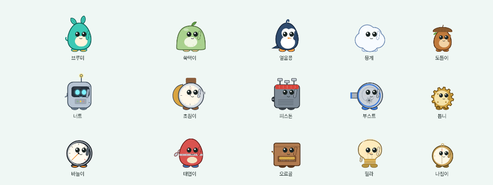

| 친구 | 모티프 | 차량 신호와 연결된 움직임 |
|---|---|---|
| 브루미 | 바람불씨(오리지널 기본 캐릭터) | 나뭇잎 귀가 속도·풍량만큼 뒤로 날림, 등 깃털 회전 |
| 쑥떡이 | 쑥떡 | 몸이 늘 말랑하게 출렁, 머리 위 쑥잎이 흔들림 |
| 얼음콩 | 꼬마 펭귄 | 부리로 바람을 불고, 입김·눈송이를 제일 좋아함 |
| 뭉게 | 뭉게구름 | 와이퍼를 켜면 몸 아래로 보슬비 |
| 도톨이 | 도토리 | 속도가 오르면 모자가 달달 흔들려 꼭 붙잡음 |
| 너트 | 꼬마 로봇 | 신호(깜빡이·브레이크 등)에 반응할 때 안테나 전구가 빨리 깜빡, 등 냉각팬이 속도만큼 회전 |
| 초침이 | 오토매틱 시계 | 시·분침이 **실제 현재 시각**, 초침이 쓸고 지나감, 등의 로터가 달릴수록 빨리 돌아 "태엽이 감김" |
| 피스톤 | 엔진 블록 | 머리 위 피스톤 3개가 속도(회전수)에 맞춰 크랭크 순서로 오르내림, 벨트 풀리 회전 |
| 부스트 | 터보차저 | 배의 임펠러가 속도만큼, 가속하면 훨씬 빠르게 회전 |
| 톱니 | 놋쇠 톱니바퀴 | 달린 거리만큼 몸(톱니)이 회전 |
| 바늘이 | 계기판 | 배의 바늘이 **실제 차속**을 가리킴(0~120, 끝 구간은 빨간 눈금) |
| 태엽이 | 양철 태엽 장난감 | 등의 태엽 열쇠가 속도만큼 돌아감 |
| 오르골 | 나무 오르골 | 달린 거리만큼 핀 실린더가 굴러가고 음표가 흘러나옴 |
| 필라 | 필라멘트 전구 | 속도가 오를수록 필라멘트가 주황에서 밝은 노랑으로 달아오름 |
| 나침이 | 놋쇠 나침반 | 깜빡이 방향으로 바늘이 휙 돌고, 주행 중 살짝 흔들림 |

기계 감성 친구(너트~나침이)는 꼬마차 바퀴에 톱니 테두리가 생기고, 초침이·톱니·태엽이·피스톤은 하늘에 큰 톱니바퀴가 달린 속도만큼 돌아갑니다. 꼬마차 색도 친구마다 다릅니다(에코·스포츠 모드에서는 초록·빨강).

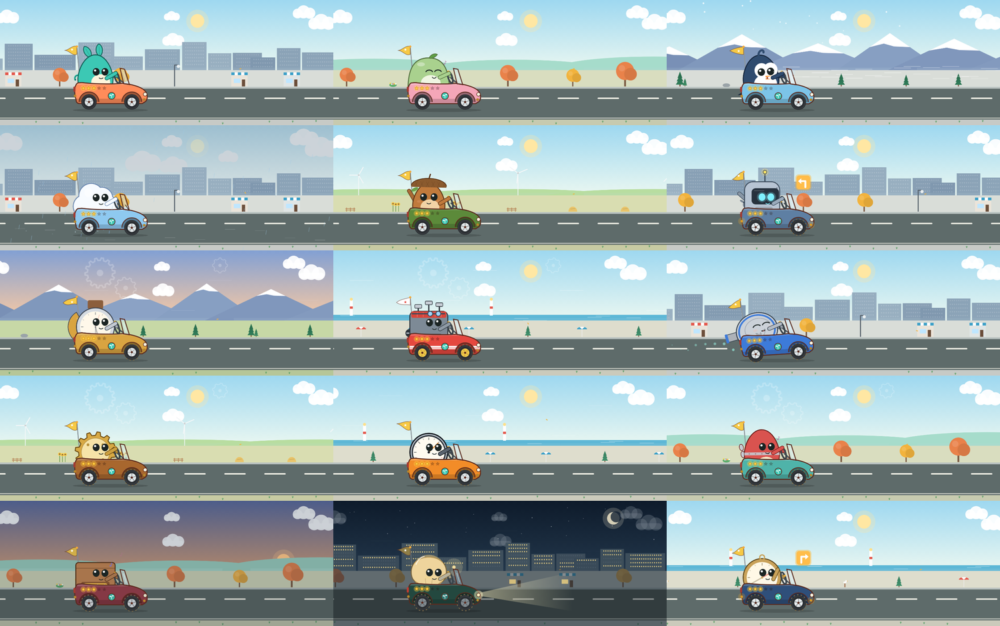

### 칼리버 테마: 차와 연결된 기계식 시계

캐릭터 대신 **손으로 다듬은 오토매틱 크로노그래프 무브먼트**를 띄우는 프리미엄 테마입니다. 그림은 매크로 제품 사진처럼 그렸습니다. 시계가 검은 벨벳 위에 떠 있고, 왼쪽 위의 부드러운 조명 하나가 비추며, 가장자리는 검게 떨어집니다. 시계 아래에는 카탈로그 명판 같은 가는 세리프 캡션 한 줄(`CALIBRE VR-01 · 파워 리저브 72시간 · 크로노그래프 0:00`)이 있습니다. **친구** 탭 위쪽의 "테마"에서 `칼리버 · 기계식 시계`를 고르면 주행 화면이 시계 뒷면(시스루 백)으로 바뀝니다. 차가 빨리 달릴수록 로터가 빨리 돌고, 공조 바람을 틀면 크라운이 돌며 태엽을 감습니다. 차에는 아무것도 쓰지 않고 읽기만 합니다.

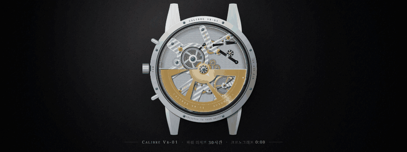

| | |
|---|---|
| 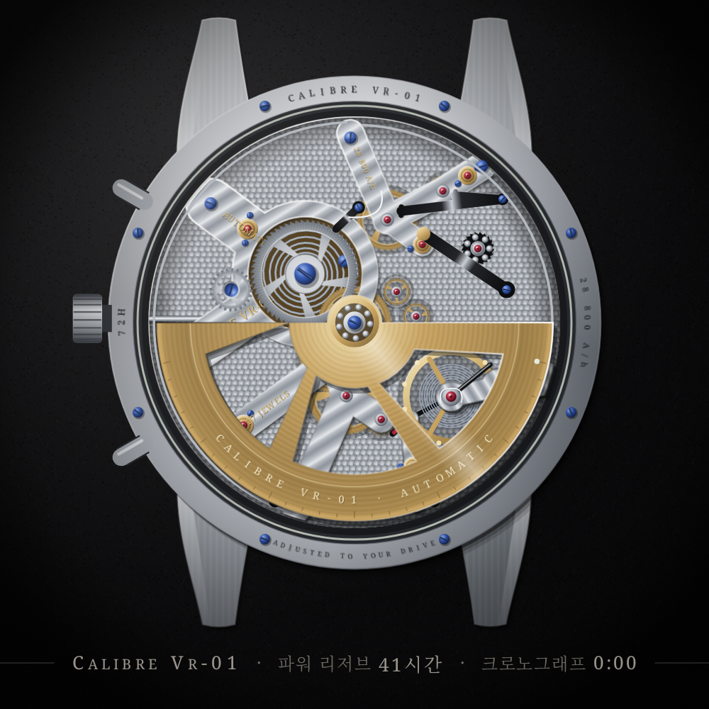 | 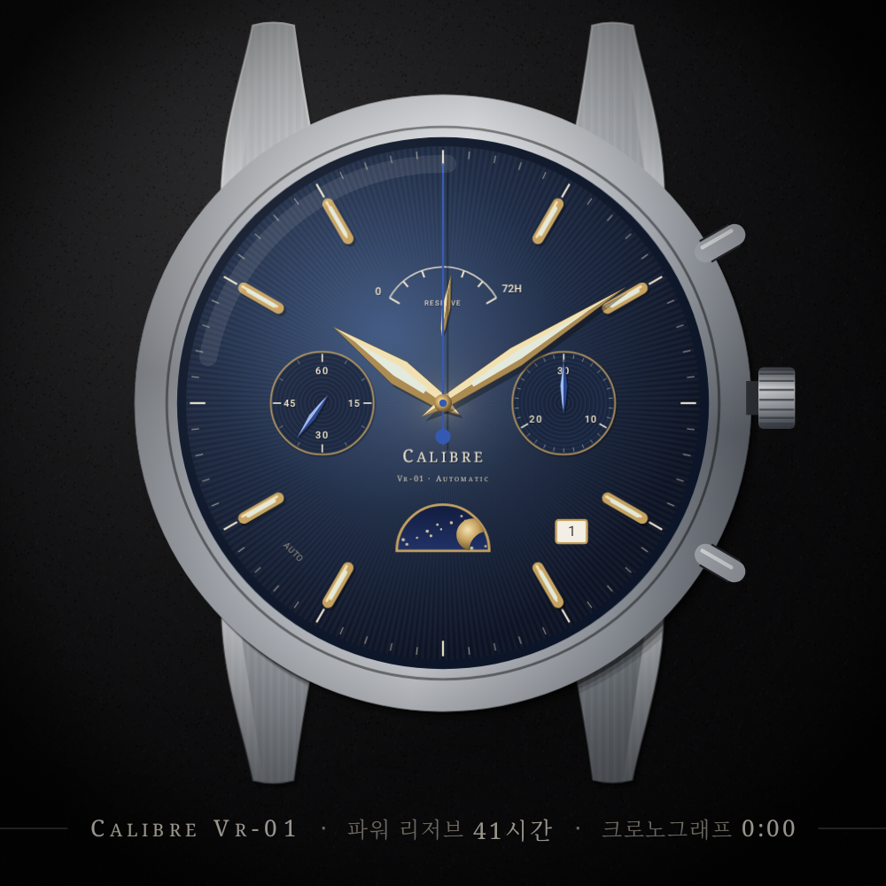 |
| 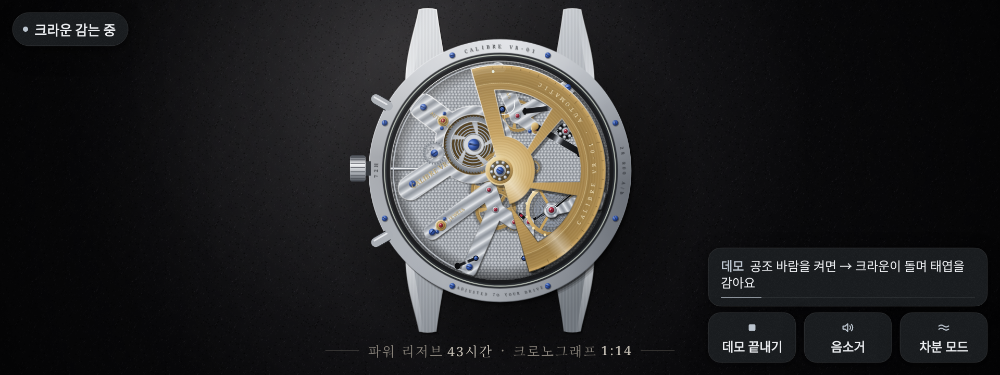 | 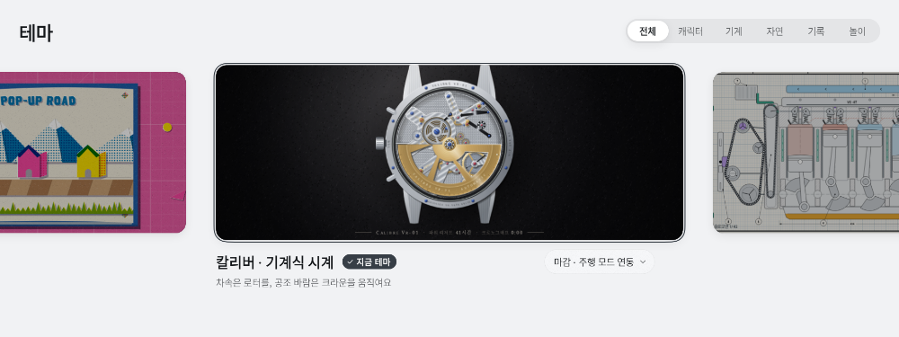 |

| 차량 신호 | 무브먼트의 반응 |
|---|---|
| 차속 | 로터(진동추)가 빨라짐: 6 + 0.9 × km/h rpm, 최대 110rpm. 무게 중심이 있는 진짜 추처럼 가속하면 앞으로, 제동하면 뒤로 출렁이고, 서면 흔들리다 4초 안에 가라앉음 |
| 공조 바람 세기 | 크라운이 돌며 태엽을 감음(0.4 + 1.6 × 단계/최대 rev/s). 크라운 휠·래칫 휠이 번갈아 반대로 돌고, 클릭(멈춤쇠)이 톱니마다 올라갔다 떨어짐. 배럴 속 태엽이 조여짐. 바람 최대·맥스 에어컨이면 크라운에 빛이 스침 |
| 에어컨 · 설정 온도 | 조명 색: 에어컨을 켜면 3초에 걸쳐 차가운 빛, 17℃ 차가운 백색 ~ 27℃ 따뜻한 빛 |
| 공조 AUTO | 문자판 7시 반 방향의 "AUTO" 각인에 불이 들어옴 |
| 서리 제거 | 사파이어 크리스털의 김이 아래부터 2.5초에 걸쳐 걷힘 |
| 와이퍼 | 크리스털에 물방울이 맺히고, 와이퍼 한 번마다 부드러운 빛이 한 번 쓸고 지나감 |
| 전조등 · 밤 | 스튜디오 조명이 꺼지고 야광만 청록빛으로 빛남: 뒷면은 케이스 플랜지의 야광 링과 로터의 km 표시, 앞면은 바늘과 인덱스 |
| 깜빡이 | 그쪽 해머가 깜빡이 박자(1.5Hz)로 공(gong)을 치고 공이 떨림. 비상등은 양쪽 |
| 출발 · 주차 | 크로노그래프 시작·정지(푸셔가 눌리고 칼럼휠이 1/7씩 돎). 다음 출발은 플라이백(리셋 해머가 떨어지고 0으로) |
| 후진 R · 주차 P | R: 로터가 반대로 돌고 리버서 휠이 바뀜 / P: 로터가 천천히 멈춤 |
| 별 · 콤보 | 별: 기어열의 루비 베어링이 배럴에서 밸런스까지 차례로 조명을 받아 붉게 번지고 가는 가로 빛줄기가 생김 / 콤보: 모든 보석이 60ms 간격으로 빛나고, 빛 한 줄기가 베젤을 한 바퀴 돈 뒤 짧게 반짝 |
| 1km마다 | 로터 테두리의 눈금 표시가 한 칸 이동 |
| 급제동 | 밸런스의 충격 방지 스프링이 한 번 휘고 로터가 출렁 (시간은 흔들리지 않음) |
| 전기차 충전 | 시계 뒤에 건메탈 와인더 링이 나타나 시계가 천천히 좌우로 돌고, 아래 캡션이 "충전 82%"로 바뀜 |
| 주행 모드 (마감 AUTO) | 일반 옐로골드, 스포츠 로즈골드, 에코 로듐·블루 스틸로 1.5초에 걸쳐 바뀜 |
| 도착 | 해머가 높은 음 2번, 낮은 음 1번 차임 |
| 안전 경고 | 장식 움직임이 모두 멈추고 70%로 어두워짐. 시간은 계속 정확 |

- 무브먼트 **Calibre VR-01**은 새로 설계한 것입니다(실제 칼리버 배치를 따르지 않음). 28,800 A/h(4Hz), 파워 리저브 72시간, 칼럼휠 크로노그래프. 톱니 수로 기어비를 맞춰 4번 휠 1rpm, 센터 휠 1rph, 이스케이프 휠 12rpm이 정확합니다(테스트로 확인).
- **시간은 항상 정확합니다.** 시·분침, 날짜, 문페이즈는 실제 시계와 시간대를 따르고, 스몰 세컨드는 1/8초씩 움직이며 밸런스는 늘 4Hz로 돕니다(리저브에 따라 진폭만 220°~300°). 시계가 멈추는 일도 없습니다(최소 6시간).
- 마감 5종: 주행 모드 연동(기본), 옐로골드, 로즈골드, 로듐·블루, 블랙 DLC. 골드 마감도 케이스는 스틸이고, 금색은 로터·휠·바늘에만 들어갑니다. 주차 중에 시계를 누르면 앞면과 뒷면이 뒤집힙니다. 주행 중에는 뒷면만 보이고 터치에 반응하지 않습니다.
- 각인은 `CALIBRE VR-01`, `AUTOMATIC`, `28 800 A/h`, `72H` 같은 모델 표기뿐이고, 앱 이름 글자는 없습니다. 아래 캡션은 주차 중에는 가는 글씨의 전체 줄이고, 주행 중에는 24sp 이상인 두 값(`파워 리저브 … · 크로노그래프 …`)만 남습니다.
- 캐릭터가 없는 테마라 브루미 음성은 기본으로 꺼집니다(설정 > `캐릭터 없는 테마에서도 음성 안내`). 배터리 부족 안내는 그대로 나옵니다.
- 데모: **데모 드라이브 → 칼리버 시계 쇼케이스 (2분)**. 데모 동안만 칼리버로 바뀌고 끝나면 원래 테마로 돌아갑니다.

### 엔진룸 테마: 내 차로 돌아가는 엔진 단면도

엔진을 잘라 속을 보여 주는 **기술 단면도(컷어웨이)** 테마입니다. 그림은 정비 매뉴얼에 인쇄된 도면처럼 그렸습니다. 5mm 격자가 있는 제도 용지(낮은 미색 종이, 밤은 어두운 슬레이트 용지에 밝은 선) 위에 계통마다 한 가지 색(흡기 연하늘, 배기 산화 적색, 오일 호박색, 냉각수 청록, 전기 보라)을 칠하고, 잘린 면에는 45° 해칭, 부품에는 번호 풍선과 지시선, 오른쪽 아래에는 부품 목록과 표제란(`VE-4T` / `VE-M1`, `SCALE 1 : 4`)이 있습니다. **친구** 탭 위쪽 "테마"에서 `엔진룸 · 컷어웨이`를 고르면, 차의 속도·기어·브레이크·주행 모드·공조 신호로 피스톤·밸브·캠·터보·변속기·벨트가 실시간으로 돌아갑니다. 전기차라면 같은 자리에 모터·인버터·배터리 단면이 나오고, 회생 제동 때 전력이 거꾸로 흐릅니다.

**화면의 회전수·기어·부스트·kW는 모두 주행 신호로 계산한 추정값입니다.** Pleos Vehicle SDK 2.3.2에는 엔진 회전수나 모터 출력을 읽는 공개 API가 없습니다(아래 "SDK 확인 결과"). 그래서 값은 표제란에만 두고, 주차 중에는 칸마다 "추정"을, 주행 중에는 작은 글씨 대신 24sp 이상의 "추정값" 머리말 하나를 붙입니다. 냉각수 온도·오일 압력·고장 코드·경고등 같은 그림은 그리지 않습니다.

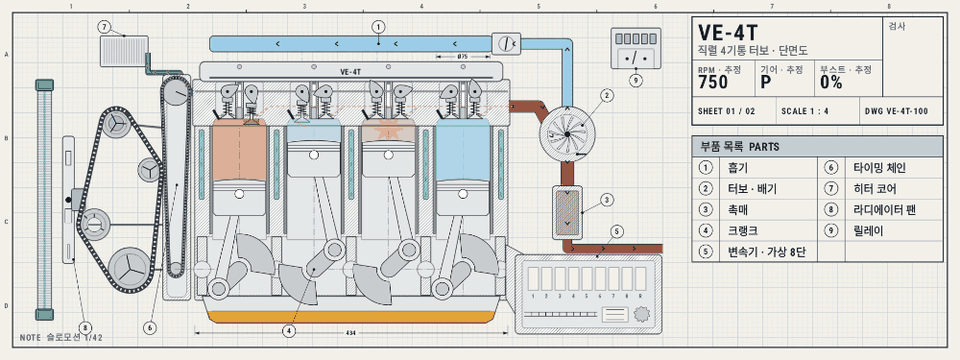

| | |
|---|---|
| 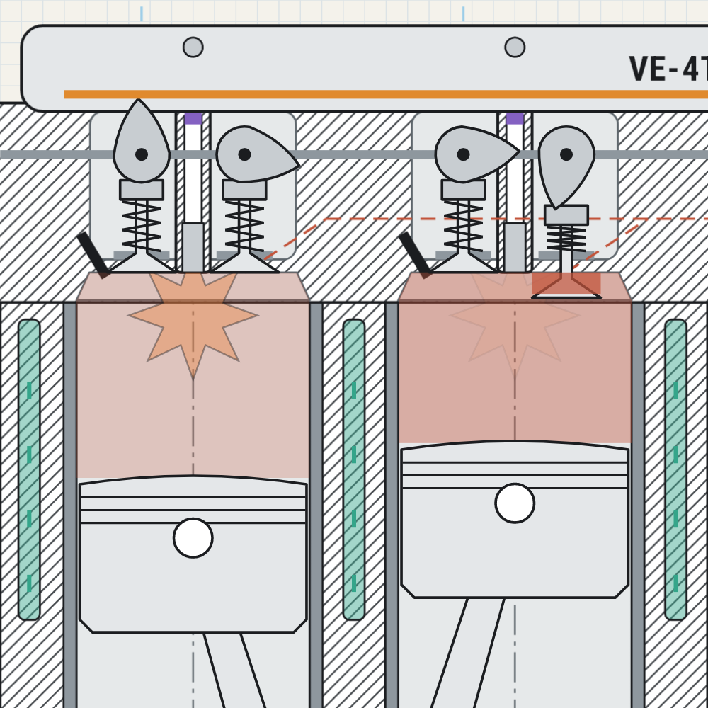 | 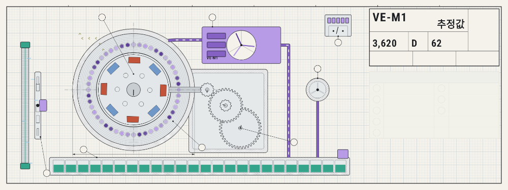 |
| 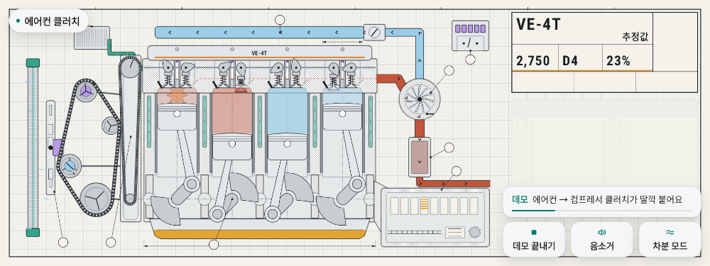 | 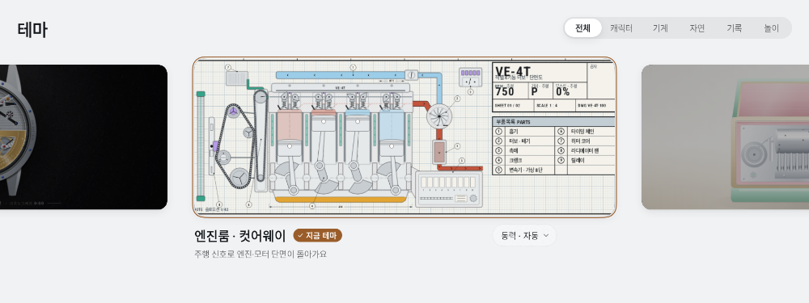 |

| 차량 신호 | 엔진 (VE-4T) | 전기 모터 (VE-M1) |
|---|---|---|
| 차속 · 기어 · 주행 모드 | 가상 8단 변속기가 회전수를 정하고, 크랭크·피스톤·밸브·캠·타이밍 체인·벨트가 그 속도로 돎. 에코는 일찍, 스포츠는 늦게 변속 | 모터 회전수 = 바퀴 회전수 × 감속비 9.0. 로터와 3상 전류가 함께 돎 |
| 가속 (위치로 계산한 가속도) | 부하 ↑: 스로틀이 열리고 흡기 흐름 화살표가 늘고 연소 기호가 진해짐, 터보가 한 박자 늦게 돎(웨이스트게이트는 85% 이상에서 열림) | 배터리 → 인버터 → 모터로 전력 펄스가 흐르고, 인버터의 3상 페이저가 출력만큼 길어짐(kW) |
| 브레이크 · 감속 | 연료 차단: 인젝터·점화·불꽃이 멈춤 | 회생 제동: 전력이 청록으로 거꾸로(모터 → 배터리), 셀 위에 청록 반짝임 |
| 급제동 | 엔진이 마운트 위에서 한 번 출렁(최대 6px, 감쇠) | 모터 하우징이 한 번 출렁 |
| P · N / R | P·N은 공회전 750rpm. R은 변속기의 후진 아이들 기어가 돎(크랭크 방향은 그대로) | P·N은 정지. R은 로터가 실제로 반대로 돌고, 축 끝에 방향 고리 |
| 에어컨 | 컴프레서 클러치가 붙고 공회전 +50rpm | 전동 컴프레서가 돎 |
| 공조 바람 · 설정 온도 | 라디에이터 팬 속도가 풍량에 비례. 24℃ 이상이면 냉각수가 히터 코어로(흐름 화살표가 청록에서 주황으로), 20℃ 이하면 우회 | 같은 방식 |
| 크루즈 | 헤드커버에 청록 띠가 하나 더 생기고, 부하 변화가 더 부드러움 | 같은 방식 |
| 서리 제거 · 와이퍼 | 도면을 덮은 투명 커버의 김이 아래부터 2.5초에 걸쳐 걷힘 · 커버에 물방울 | 같은 방식 |
| 전조등 · 밤 | 도면이 어두운 슬레이트 용지(밝은 선)로 바뀌고, 발전기 풀리에 보라색 점이 켜짐 | 도면이 어두운 슬레이트 용지로 바뀜 |
| 깜빡이 | 퓨즈박스 릴레이가 깜빡이 박자(1.5Hz)로 딸깍, 비상등은 양쪽 | 같은 방식 |
| 문 열림 (주차 중) | 작업등이 켜져 도면 위에 따뜻한 빛이 고임 | 같은 방식 |
| 별 · 콤보 | 표제란 칸에 초록 검사 도장이 찍히고, 다음 연소가 깨끗한 푸른 불꽃 / 번호 풍선과 부품 목록에 체크 표시가 차례로(0.15초 간격) 붙음 | 표제란에 초록 검사 도장 / 같은 방식 |
| 1km마다 | 변속기 안 주행거리 드럼이 한 칸 돎 | 같은 방식 |
| 충전 · 배터리 % | (해당 없음) | 충전 케이블로 에너지가 들어오고, 셀은 실제 배터리 %까지(15% 이하는 호박색) |
| 도착 후 P | 시동이 꺼지듯 크랭크가 2초에 걸쳐 멈추고 라디에이터 팬이 8초 더 돎 | 로터가 천천히 멈춤 |
| 안전 경고 | 장식 움직임이 모두 멈추고 70%로 어두워짐(표제란의 추정값은 계속 바뀜) | 같은 방식 |

- 엔진 **VE-4T**(직렬 4기통 약 1.4L 터보, DOHC 16밸브, 점화순서 1-3-4-2)와 모터 **VE-M1**(8극 영구자석, 48슬롯, 감속비 9.0)은 새로 설계한 것입니다. 보어 75 · 스트로크 79 · 커넥팅 로드 135mm를 한 축척으로 그려서 로드 길이가 변하지 않습니다(테스트로 확인). 실린더마다 앞에서 본 단면을 나란히 놓는 설명용 단면도 방식입니다.
- **가상 변속기**: 기어비 4.71/3.14/2.11/1.67/1.29/1.00/0.84/0.67, 종감속 3.20, 타이어 반경 0.33m. 100km/h 8단 = 약 1,724rpm. 히스테리시스와 1.2초 간격으로 변속이 왔다 갔다 하지 않습니다.
- **슬로모션**: 진짜 크랭크는 2,000rpm에서 1초에 33바퀴를 돌아 그대로 그리면 거꾸로 도는 것처럼 보이고 깜빡입니다. 그림은 늘 느리게(최대 1.4바퀴/초) 돌고, 연소 불꽃은 부드럽게 켜졌다 사라지며 1초에 3번을 넘지 않습니다. 표제란의 회전수 값만 실시간입니다.
- 주차 중에는 번호 풍선의 숫자, 부품 목록(흡기·터보 · 배기·촉매·크랭크·변속기·인버터 등), 치수와 표제란의 작은 글씨가 보이고, 그림을 누르면 1번 실린더(또는 모터) 단면 확대와 전체 보기가 바뀝니다. 주행 중에는 작은 글씨가 0.3초에 사라지고(풍선은 모양만, 부품 목록은 빈칸) 표제란에는 `VE-4T`(또는 `VE-M1`)와 "추정값", 24sp 이상의 값 세 개만 남습니다. 전체 보기만 보이고 터치에 반응하지 않습니다. 동력은 자동(배터리 신호로 판단, 주행 중에는 바뀌지 않음)·엔진·전기 모터 중에서 고릅니다.
- 캐릭터가 없는 테마라 브루미 음성은 기본으로 꺼집니다(설정 > `캐릭터 없는 테마에서도 음성 안내`). 배터리 부족 안내는 그대로 나옵니다.
- 데모: **엔진룸 쇼케이스 (2분)**, **전기 모터 쇼케이스 (1분)**. 데모 동안만 엔진룸 테마로 바뀝니다.
- **SDK 확인 결과**: Gradle 캐시의 Vehicle 2.3.2 / vehicle-data 1.1.11을 살펴보니 `ENGINE_RPM`, `ENGINE_COOLANT_TEMP`, `ENGINE_STATE` 같은 속성 ID는 `PleosPropertyIds` 열거형에 있지만, 이를 읽는 메서드는 내부(난독화된) 헬퍼뿐이고 공개 인터페이스(Brake·Gear·Fuel·Safety·EvBattery 등)에는 회전수·모터 속도·출력을 주는 함수가 없습니다. 새 퍼미션은 추가하지 않았습니다.

### 테마 갤러리

**친구** 탭이 테마 갤러리입니다. 8:3 창이 한 줄로 늘어서고, 지금 테마의 창만 실제 장면이며 나머지 창은 정지 그림이라 화면이 가볍습니다. 위쪽에서 전체 · 캐릭터 · 기계 · 자연 · 기록 · 놀이로 골라 볼 수 있습니다. 창을 누르면 무대(전체 화면)로 열리고, 그곳에서 넘겨 보거나 "이 테마로 달리기"로 적용합니다. 기본은 꼬마차입니다.

| 분류 | 테마 | 한 줄 | 화면 |
|---|---|---|---|
| 캐릭터 | 꼬마차와 친구들 | 15명의 친구가 꼬마차를 타고 같이 달려요 | 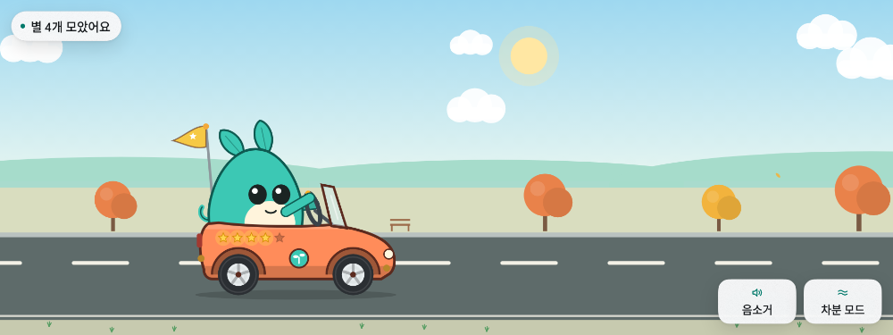 |
| 기계 | 칼리버 · 기계식 시계 | 차속은 로터를, 공조 바람은 크라운을 | 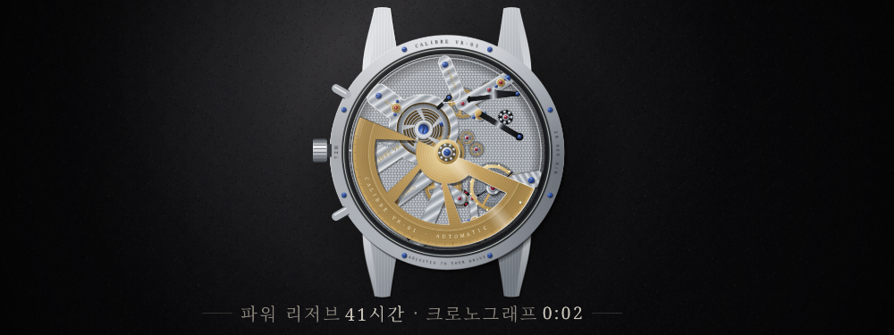 |
| 기계 | 엔진룸 · 컷어웨이 | 주행 신호로 엔진·모터 단면이 돌아가요 | 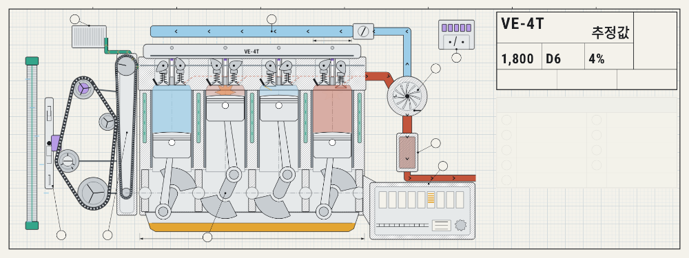 |
| 기계 | 오르골 · 핀 실린더 | 차속이 템포를, 달린 거리가 태엽을 감아요 |  |
| 기계 | 구슬 장치 | 브레이크·깜빡이·와이퍼가 구슬 정거장을 움직여요 | 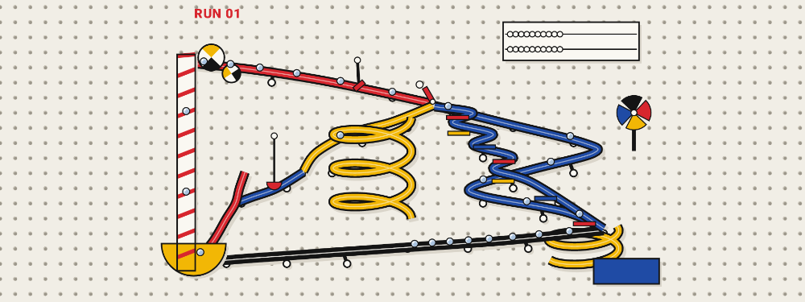 |
| 자연 | 유리병 정원 | 달린 거리만큼 자라고, 부드럽게 달리면 꽃이 펴요 |  |
| 자연 | 아쿠아리움 | 물속에 들어간 시점. 가속하면 수면이 기울어요 | 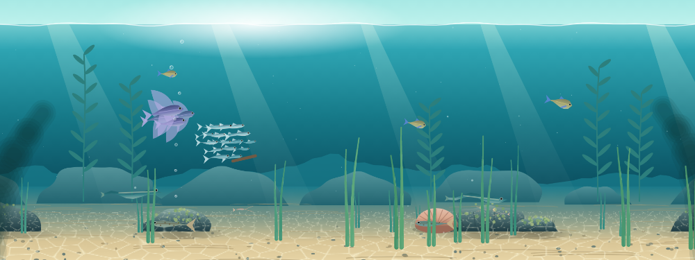 |
| 자연 | 궤도 · 작은 태양계 | 1km를 달리면 우주선이 행성을 한 바퀴 | 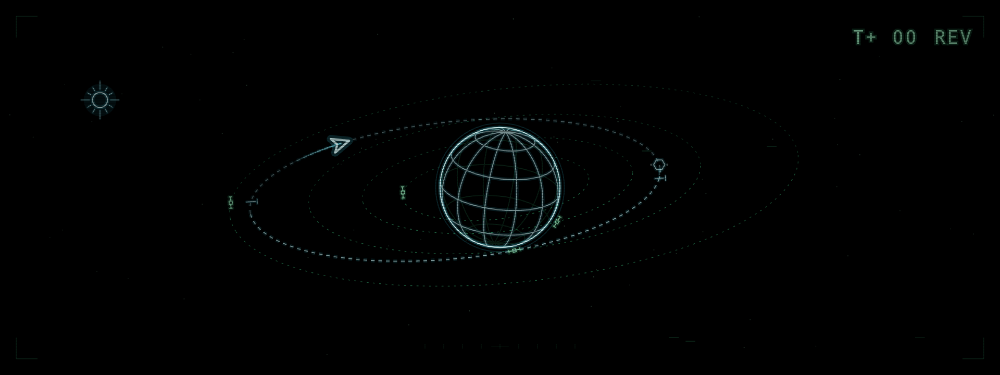 |
| 기록 | 보물지도 여행 일지 | 지나온 길만 그린 그림 지도 (실제 지도가 아님) | 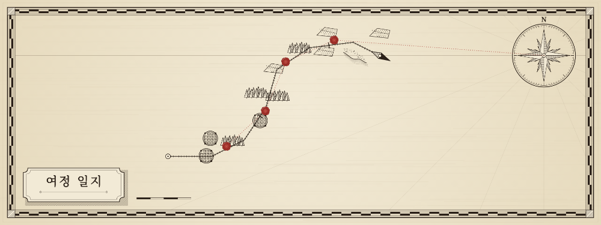 |
| 놀이 | 종이 팝업북 | 종이접기 자동차와 종이학이 팝업북 길을 달려요 | 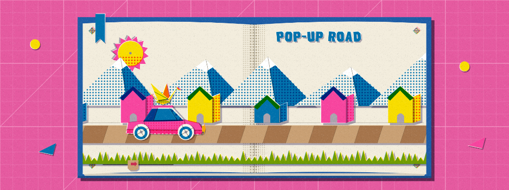 |
| 놀이 | 도트 월드 · 8비트 | 헬멧 쓴 조종사가 도트 탐사차로 달리는 8비트 길 | 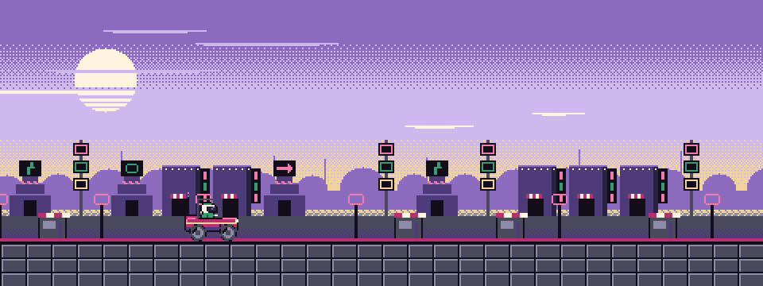 |

**꼬마차와 친구들만 브루미의 세계입니다.** 나머지 열 테마는 각자 독립된 세계라서 그림 기법, 팔레트, 조명, 글꼴, 보상 물건, 등장하는 것이 모두 다릅니다(종이 팝업북은 리소 인쇄, 도트 월드는 16색 도트, 칼리버는 매크로 사진, 엔진룸은 정비 매뉴얼 도면, 오르골은 밝은 스튜디오 제품 사진, 구슬 장치는 바우하우스 장난감, 유리병 정원은 얕은 초점의 자연 사진, 아쿠아리움은 물속 시점, 궤도는 벡터 형광 화면, 보물지도는 동판화 해도). 이 열 테마에는 브루미, 꼬마차, 친구, `VROOMI` 글자, 금색 별이 나오지 않습니다. 같은 "부드러운 운전" 보상도 테마마다 자기 세계의 물건(색종이 동그라미, 보석 조각, 루비, 검사 도장, 진주빛 핀, 줄무늬 구슬, 꽃봉오리, 진주, 벡터 위성, 밀랍 봉인)으로 나옵니다. 어떤 신호에 무엇이 반응하는지, 시간·수치·규칙은 그대로입니다.

**모든 새 테마가 함께 지키는 것** (공통 테마 키트 `character/theme/ThemeKit.kt`, `render/theme/ThemeRender.kt`):
- 차량은 읽기만 합니다. 테마마다 쇼케이스를 재생하며 차량 쓰기가 0회인지 `ThemeContractTest`로 확인합니다.
- 반짝임·깜빡임은 모두 `FlashGuard`를 거쳐 화면의 같은 영역에서 1초에 3번을 넘지 않습니다.
- 빨리 달리거나 급가속해도 보상이 늘거나 더 화려해지지 않습니다. 멈춰도 실패처럼 보이지 않습니다. 아무것도 죽거나 시들지 않습니다.
- 안전 경고 때는 장식이 멈추고 70%로 어두워지며 상태 칩이 사라집니다. 차분 모드는 움직임을 절반으로, 애니메이션 끄기는 정지 그림으로 바꿉니다.
- 모든 신호를 알 수 없을 때(전부 null)도 조용한 정지 장면을 보여 줍니다.
- 장면 안의 글자는 주행 중에는 24sp 이상인 것만 정보로 남고, 그보다 작은 글자는 0.3초에 걸쳐 사라졌다가 주차하면 돌아옵니다.
- 캐릭터가 없는 열 테마는 브루미 음성이 기본으로 꺼집니다(설정 > `캐릭터 없는 테마에서도 음성 안내`). 배터리 부족 안내는 그대로 나옵니다.
- 정적 레이어 비트맵은 모든 테마가 **48MB 한도** 하나를 나눠 쓰고, 보이지 않는 테마의 캐시는 바로 해제합니다.
- 소리가 있는 테마(오르골, 구슬 장치, 도트 월드)의 "테마 소리"는 기본값이 꺼짐입니다. 켜면 미디어 소리로 재생되고, 길안내 음성이나 브루미 음성이 나올 때는 20%로 줄이며, 통화 등으로 오디오 포커스를 잃으면 멈춥니다. Pleos 실기기의 오디오 포커스 동작은 아직 확인하지 못했습니다.

### 고급스러운 인터페이스와 테마 전환

테마 열한 개 사이를 오갈 때 화면이 끊기지 않습니다. 지금 보고 있는 장면은 하나의 살아 있는 창이고, 그 창이 홈 · 탭 옆 칸 · 갤러리 카드 · 무대(전체 화면) 사이를 옮겨 다닙니다. 자리만 바뀔 뿐 장면이 처음부터 다시 시작하지 않습니다.


**화면 체계.** 장면이 주인공이고 앱 화면은 그 둘레를 조용히 받칩니다. 간격은 4·8dp 단위, 글자는 역할 6개(큰 제목 40 · 제목 30 · 소제목 24 · 본문 22 · 보조 20 · 설명 18sp, 주행 중에는 24sp 이상), 재질은 얇음·보통·두꺼움 3단계(가는 테두리와 두 겹 그림자, 흐림은 API 31 이상에서 주차 중에만)입니다. 강조색은 테마 색을 화면용으로 눌러 써서 밝은·어두운 화면 모두 명암비 4.8:1 이상입니다. 앱 버튼은 왼쪽 위(상태)와 오른쪽 아래(동작) 두 구석에만 있고, 엔진룸 계기·궤도 수치·지도 글씨 같은 테마의 정보는 이 구석을 피해 그려집니다(`character/.../render/theme/ChromeZones.kt`, 앱과 같은 수치를 테스트로 맞춤).

| 설정 | 데모 고르기 | 주행 중 (엔진룸) |
|---|---|---|
| 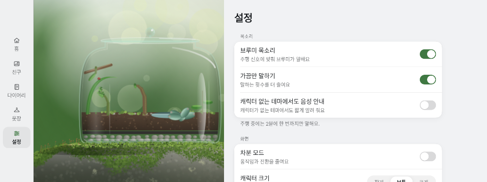 | 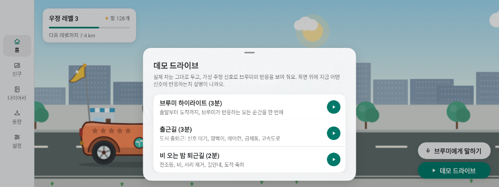 |  |

| 갤러리 | 무대 | 궤도 입장 (50%) |
|---|---|---|
| 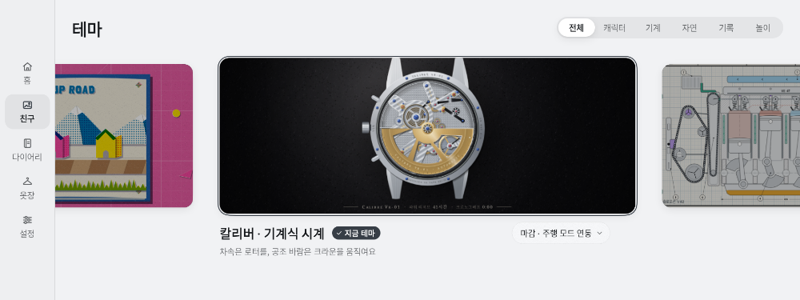 | 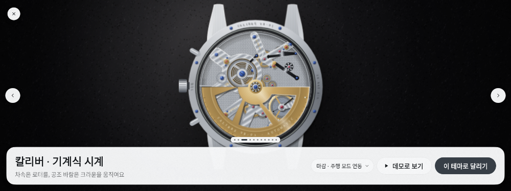 | 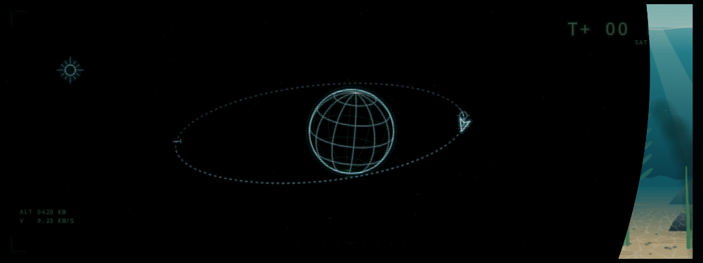 |

| 전환 | 무엇이 어떻게 움직이나 | 주행 중에는 |
|---|---|---|
| 앱 시작 | 첫 화면의 밤색이 0.25초에 걸쳐 지난번 테마의 배경색으로 바뀌고, 장면이 0.45초에 걸쳐 떠오른 뒤 0.12초 늦게 레일과 배지가 12dp 올라옵니다 | 같음 (불투명도만) |
| 홈 ↔ 다른 탭 | 장면이 전체에서 왼쪽 42% 칸으로 줄어듭니다. 크기가 바뀌는 동안은 직전 화면이 덮고, 멈추면 0.12초에 실제 장면으로 바뀝니다. 패널은 가로로 24dp 들어오고 제목 다음 묶음이 0.035초 간격으로 나타납니다. 탭 표시 캡슐은 미끄러지며 이동 중에 15%까지 늘어납니다 | 탭 없음 |
| 갤러리 카드 → 무대 | 카드가 살짝 들린 뒤 화면 전체로 커지고 모서리는 32dp에서 0이 됩니다. 커지는 동안은 카드 그림이 보이고 40~55% 지점에서 실제 장면이 그 아래로 스며듭니다. 뒤의 갤러리는 0.94배로 물러나며 어두워지고 흐려집니다. 70%에서 무대 버튼이 차례로 올라옵니다 | 갤러리·무대 없음 |
| 무대 → 갤러리 | 아래로 당기면 손을 따라 0.86배까지 작아지고 모서리가 둥글어집니다. 35% 또는 초당 900dp를 넘기고 놓으면 카드로 돌아갑니다. 미리 보기만 했다면 그 장면은 그 순간의 그림으로 카드에 들어가고, 지금 테마가 제 카드에서 조용히 다시 입장합니다 | 없음 |
| 무대에서 좌우로 넘기기 | 손을 대는 순간 지금 장면이 사진처럼 멈추고 손가락의 0.35배로 따라오며 어두워집니다. 옆 테마 그림은 손가락을 그대로 따라옵니다. 30% 또는 초당 800dp에서 넘어가고 실제 장면이 0.15초에 걸쳐 들어옵니다. 처음과 마지막 테마에서는 0.35배 고무줄처럼 버팁니다 | 없음 |
| 화살표 | 다음 테마가 자기 세계의 방식으로 입장합니다 (아래 표) | 없음 |
| 이 테마로 달리기 | 무대 버튼이 8dp 내려가며 사라지고, 무대가 그대로 홈 화면이 되며 레일이 돌아옵니다. 장면은 멈추지 않고, 설정 저장은 움직임이 시작된 뒤에 합니다. "테마를 바꿨어요"가 2초 보입니다 | 없음 |
| 데모 시작·끝 | 고르는 시트가 데모 배지 자리로 접히고, 데모 테마가 다르면 먼저 입장한 뒤 출발합니다. 끝나면 주차 화면, 오늘의 드라이브 카드, 그리고 카드를 닫거나 4초가 지나면 내 테마가 조용히 돌아옵니다 | 전환은 불투명도만 (0.4초) |
| 주차 → 주행 | 레일·패널·말풍선·배지가 0.16초에 사라지고(움직이지 않음), 0.08초 뒤 장면이 전체로 넓어지며, 0.3초에 칩과 큰 버튼 두 개가 제자리에서 나타납니다 | 이것이 주행 화면 |
| 주행 → 주차 | 큰 버튼이 0.16초에 사라지고 장면이 떠났던 자리로 돌아간 뒤 레일과 패널이 차례로 돌아옵니다 | — |
| 안전 경고 | 진행 중인 전환을 0.15초 안에 불투명도로만 끝낸 뒤, 기존처럼 오른쪽 위 구석으로 물러나 어두워집니다. 경고 동안은 새 전환을 시작하지 않습니다 | 같음 |
| 시트·카드·말풍선 | 시트는 아래에서 올라오고 뒤는 35%(밤)·25%(낮) 어두워지며 흐려집니다. 끌어내려 닫을 수 있습니다. 환영 카드는 24dp 올라오며 줄마다 0.06초 간격, 오늘의 드라이브는 오른쪽에서 32dp 들어오고 숫자는 0.6초 동안 셉니다. 말풍선은 친구 쪽에서 커집니다 | 칩 글자는 0.25초 교차, 자리는 그대로 |
| 친구 바꾸기 | 시트에서 다른 친구를 고르면 직전 장면이 위에 남았다가 0.2초에 걸쳐 사라집니다. 새 장면은 처음부터 불투명해서 배경은 그대로이고 친구만 바뀝니다 (칼리버 마감, 엔진룸 동력도 같음) | 시트 없음 |

**테마마다의 입장** (보통 0.4~0.9초, 각자의 세계에서 나온 움직임. 훨씬 밝은 테마로 들어갈 때는 번쩍임 규칙에 따라 1.1초 이상 걸립니다). 화면이 드러나는 동안 장면 안에서도 그 테마다운 움직임이 함께 일어납니다(`SceneOptions.intro`. 평소 값은 1이라 평소 장면에는 영향이 없음):

| 테마 | 화면이 드러나는 방식 | 장면 안에서 |
|---|---|---|
| 꼬마차와 친구들 | 세계가 2% 아래에서 내려앉으며 나타남 | 꼬마차가 바퀴를 굴리며 왼쪽에서 120dp 들어와 멈추고, 서스펜션이 2dp 눌렸다 돌아옴 |
| 종이 팝업북 | 가운데 접힌 곳에서 두 쪽이 70°에서 펴지고, 종이 그늘이 걷힘 | 종이 산, 풍경, 종이접기 자동차, 앞쪽 풀 띠가 접힌 선을 축으로 차례로 일어서고, 살짝 넘어갔다가 멈춤 |
| 칼리버 | 화면이 어두워진 뒤 무브먼트가 어둠에서 떠오르고, 20° 기운 반사광 띠가 한 번 지나감 | 조명이 검은 노출에서 밝아지며 베젤에 빛이 한 번 지나가고, 바늘이 10초 늦은 자리에서 지금 시각으로 미끄러지듯 맞춰짐 |
| 엔진룸 | 1px 단면 선이 왼쪽에서 오른쪽으로 도면을 자르듯 지나감 | 분해도가 조립되듯 움직이는 부품이 10dp 위에서 일정한 속도로 제자리에 내려앉음 |
| 오르골 | 위쪽을 축으로 뚜껑처럼 열리고, 뚜껑 그늘이 위에서부터 걷힘 | 연주 중이면 실린더가 멈춘 상태에서 돌기 시작함 |
| 구슬 장치 | 대각선으로 뒤(왼쪽 위)에서 앞으로 레일이 드러남 | 판을 덮은 빨간 원, 노란 사각형, 파란 사분원이 세 방향 가장자리로 곧게 미끄러져 나감 |
| 유리병 정원 | 안개가 끼었다가 위에서 아래로 걷힘 | 렌즈 초점이 맞듯 장면이 4% 크게 보였다가 제자리로 오고, 식물이 98%에서 100% 높이로 흙에서 차례로 올라옴 |
| 아쿠아리움 | 물결 선을 따라 물이 아래에서 차오름 | 물고기가 화면 밖에서 차례로 헤엄쳐 들어옴 |
| 궤도 | 태양을 중심으로 원이 열림 | 궤도선이 형광 빔으로 한 번 훑듯 그려지고, 위성은 행성 옆에서 제 궤도로 나가며, 구석의 텔레메트리 글자는 마지막에 나타남 |
| 보물지도 | 말린 가장자리와 함께 지도가 왼쪽에서 오른쪽으로 펼쳐짐 | 지나온 길의 새김 선이 출발점부터 다시 그어지고, 지도 기호와 밀랍 봉인이 잉크를 따라 나타남 |
| 도트 월드 | 4 × 4 순서 디더로 가상 픽셀이 16단계에 하나씩 켜짐 (한 번 켜진 픽셀은 그대로, 번짐 없음) | 16픽셀 타일 열 단위로 왼쪽부터 한 열씩 드러남 (맨 앞 열은 디더) |

**지키는 것**
- 살아 있는 테마 장면은 언제나 하나입니다. 떠나는 테마는 사진 한 장으로 바꾸고, 그 캐시를 먼저 비운 뒤 새 테마를 준비합니다(`ui/passage/ThemePassage.kt`, 단위 테스트). 가장 무거운 전환(궤도 → 도트 월드)도 정적 레이어·사진·카드 그림을 합쳐 약 33MB입니다.
- 모든 움직임은 도중에 목표가 바뀌어도 속도를 이어받는 스프링입니다. Press 0.14초, Snappy 0.28초, Smooth 0.43초, Passage 0.72초로, 각자 1% 안에 멈추는 시간과 감쇠비로 정의했습니다. 불투명도만 시간 곡선을 씁니다.
- 번쩍임 검사: 테마 11개의 모든 순서쌍 110개를 실제 전환 곡선으로 60fps 계산해, 화면 평균 밝기가 한 프레임에 10%를 넘게 바뀌지 않는지, 10% 이상의 밝기 반전이 1초에 3번을 넘지 않는지, 어두운 테마에서 밝은 테마로 갈 때 0.45초 이상 걸리는지 확인합니다(`LuminanceFlashTest`, 테마 밝기는 `app/src/test/resources/theme_luminance.json`에서 측정값으로 읽음).
- 주행 중에는 불투명도만 바뀝니다. 칩과 버튼은 제자리에 있고, 흐림·겹친 움직임·누름 확대·진동이 없습니다.
- 시스템 애니메이션 배율이 0이거나 차분 모드를 켜면 모든 전환이 0.2초 교차가 됩니다(밝기 차이가 큰 두 테마 사이는 0.7초). 배율이 0.5배면 직접 만든 전환도 두 배 빨라집니다.
- 화면 크기: 실제 차량 화면의 해상도와 밀도는 아직 확인하지 못해서, 앱 화면 전체를 네 가지 화면에서 그려 봤습니다. 1920 × 720 px를 240dpi(1280 × 480dp)와 213dpi(1442 × 541dp)로, 1280 × 720dp, 1024 × 600dp입니다. 버튼은 어느 화면에서나 같은 dp 크기이고, 테마 그림은 앱 창의 실제 높이를 받아 버튼 구역을 그 크기 그대로 피합니다. 칼리버 아래 글줄처럼 화면이 좁아 다 들어가지 않는 정보는 덜 중요한 부분부터 덜어 냅니다(파워 리저브는 항상 남음).

  | 1280 × 480dp, 데모 중 | 1280 × 480dp, 주차 | 1024 × 600dp, 데모 중 |
  |---|---|---|
  | 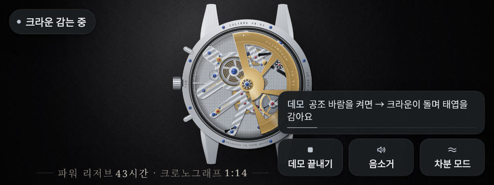 | 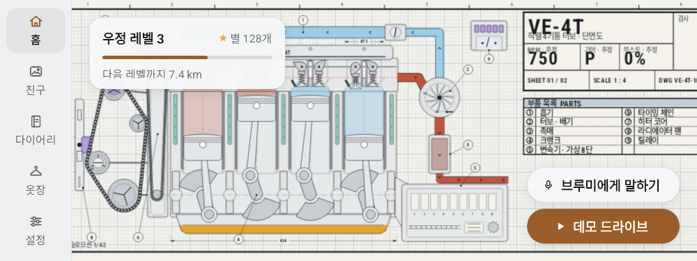 | 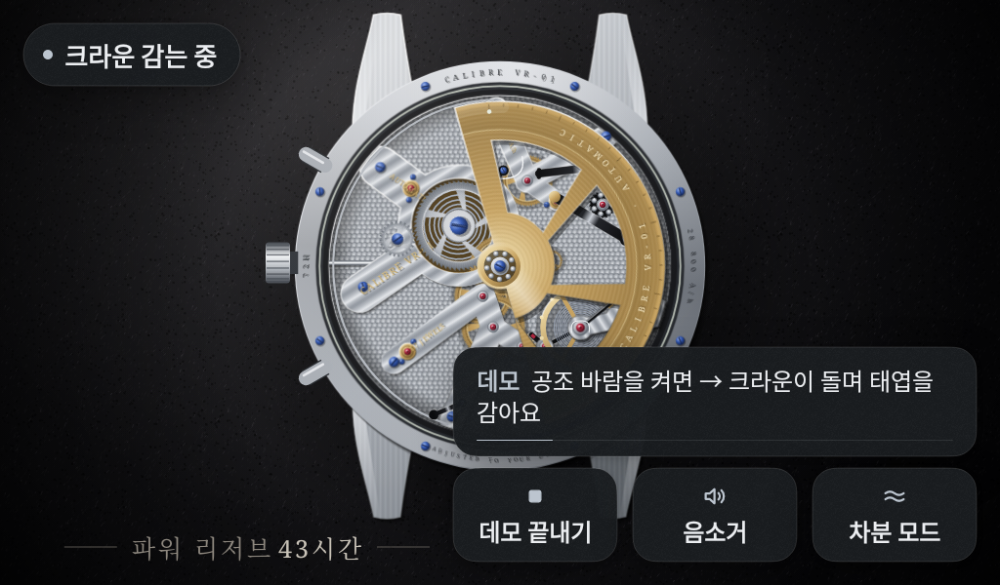 |
- 반투명 재질의 흐림은 Android 12(API 31) 이상에서만 쓰고, 그 아래와 주행 중에는 조금 더 불투명한 색으로 대신합니다. 글꼴은 기기 기본 글꼴, 아이콘은 코드로 직접 그렸습니다.

### 오르골 테마: 핀 실린더가 곧 악보

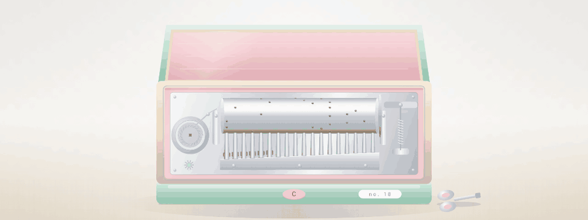

밝고 산뜻한 스튜디오 제품 사진처럼 그렸습니다. 이음매 없는 미색 배경과 옅은 리넨 위에 민트 에나멜 상자, 옅은 자작나무 테두리, 분홍 안감의 뚜껑, 은색 실린더와 빗살이 있고, 앞면의 에나멜 명판에는 가는 소문자로 `no. 18`이 적혀 있습니다. 놋쇠나 어두운 나무는 쓰지 않습니다.

| 차량 신호 | 오르골 |
|---|---|
| 차속 | 템포 = 60 + 66 × (차속 ÷ 110), 6BPM 단위, **마디가 바뀔 때만** 최대 ±12BPM씩 |
| 주행 거리 | 100m마다 태엽이 한 칸 감김 (최대 60칸) |
| 정지 (D) / P | 페르마타(박자를 마치고 멈춤) / 감긴 태엽으로 혼자 연주, 태엽이 풀릴수록 느려지다 으뜸화음으로 끝남 |
| 깜빡이 | 래칫의 클릭 스프링이 깜빡이 박자로 똑딱 |
| 별 · 콤보 | 장식음 한 줄, 튕기는 자리의 핀이 잠깐 진주빛으로 켜짐 / 진주빛 핀이 저음에서 고음으로 아르페지오처럼 켜지고, 다음 프레이즈에서 온음 위로 조 바꿈 |
| 급제동 | 분홍 펠트 댐퍼가 빗살을 누름 |
| 와이퍼 · 서리 제거 · 밤 | 유리 뚜껑의 물방울 · 김이 아래부터 걷힘 · 주변이 짙은 따뜻한 회색으로 어두워지고 왼쪽 낮은 곳의 따뜻한 램프 하나가 상자를 옆에서 비춤 |
| 1km | 은색 카운터 바퀴가 한 칸 |

- 실린더의 핀이 **실제로 곧 연주할 악보**입니다. 작곡기가 4마디 앞까지 쓰면 그 음이 실린더 뒤쪽에 핀으로 꽂히고 돌아 나옵니다. 핀이 빗살을 튕기는 순간과 소리가 같습니다(테스트로 확인).
- 곡은 손으로 쓴 오리지널 2마디 동기 8개와 규칙 기반 작곡기로 만듭니다. 유명한 곡(동요, 저작권이 끝난 클래식, 벨소리 등) 14개와 음정이 6개 이상 연속으로 겹치지 않는지 테스트로 확인합니다.

### 유리병 정원 테마: 운전할수록 자라는 병 속 정원


얕은 초점의 자연 사진처럼 그렸습니다. 유리병은 바깥 이끼 낀 바위 위에 놓여 있고, 병과 그 발치만 또렷하며 뒤의 정원은 크게 흐려진 보케 원으로 보입니다. 유리에는 굴절 띠, 햇빛 반사, 초록빛 두꺼운 가장자리, 그림자 속에 모인 빛, 맺힌 물방울이 있습니다. 장면 안에 글자는 없습니다.

| 차량 신호 | 유리병 정원 |
|---|---|
| 주행 거리 | 1km마다 식물이 자람 (L-시스템, 식물마다 상한), 다음 여행에도 그대로 |
| 5분 동안 부드러운 주행 | 꽃 한 송이 (빠르기와는 무관) |
| 가속 · 급제동 | 연못 물과 늘어진 잎이 기울어짐 (최대 4°) · 한 번 출렁, 이슬이 떨어짐 |
| 공조 바람 · 에어컨 · 설정 온도 | 잎이 흔들리는 폭 · 유리 안쪽 김 · 햇빛의 색온도 |
| 와이퍼 · 서리 제거 · 밤 | 뚜껑 아래 작은 구름이 병 속에 비, 바깥 정원은 회색빛 · 김이 아래부터 걷히고 큰 물방울이 천천히 흘러내림 · 달빛 푸른 정원과 병 안팎의 반딧불이(0.5Hz 이하) |
| 깜빡이 | 무당벌레가 풀잎을 따라 그쪽으로 걸어감 |
| 별 · 콤보 · 1km | 새싹이나 꽃봉오리 · 이끼 위로 작은 꽃이 물결처럼 피었다 닫힘(4초) · 어린 나무에 잎 한 바퀴 |
| 충전 · 도착 | 배터리가 찰수록 햇빛이 밝아짐 · 금빛 저녁 햇살로 바뀌고 유리 뚜껑에 나방이 앉음 |

- 계절은 기기 날짜를 따릅니다. 뒤 정원의 보케 색(봄 분홍, 여름 초록, 가을 호박색, 겨울 옅은 파랑)과 잎 색이 바뀌고, 겨울에는 유리에 서리 깃털이 생깁니다. 저장하는 것은 성장 수치와 꽃 수, 계절뿐이고 위치나 시각은 저장하지 않습니다.

### 보물지도 테마: 지나온 길을 그린 여행 일지

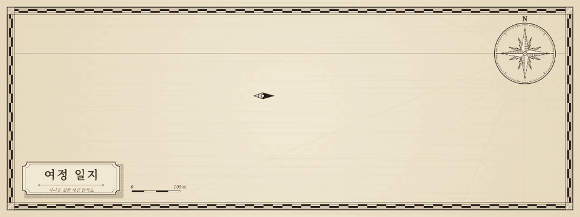

화면 가득 찬 동판화 해도처럼 그렸습니다. 상아색 종이에 흑백 눈금이 번갈아 있는 테두리, 32방위 나침도, "여정 일지"라고 새긴 제목 장식틀이 있고, 모든 명암은 해칭과 점묘로 냅니다. 색은 철 잉크 갈색·검정과 꼭두서니 빨강 하나뿐입니다. 길의 맨 앞은 나침반 바늘이고 얼굴은 없습니다.

| 차량 신호 | 보물지도 |
|---|---|
| 위치 (기기 안에서만) | 지나온 길이 나침반 바늘 뒤로 항적 기호(가는 선과 가로 눈금)로 새겨짐. 갓 새긴 선은 3초간 더 굵음 |
| 30초 넘게 정지 | 둥근 "쉼터" 기호 (2분에 한 번까지, 글자는 주차 중에만) |
| 급제동 · 깜빡이 | 잉크 튄 자국 · 바늘 옆 그쪽에 작은 새긴 화살표 (앞길을 가리키지 않음) |
| 풍경 · 와이퍼 · 밤 | 지도 기호(성곽 도시 평면, 해칭한 원뿔 숲, 점을 찍은 밭, 점묘 해안과 물결선, 우모선 산)와 이탤릭 지명 · 빗물이 마른 자국과 갓 새긴 선의 번짐 · 촛불 비네팅 |
| 별 · 콤보 · 1km | 길 옆에 꼭두서니빛 밀랍 봉인 · 봉인을 잇고 나침도에서 뻗어 나오는 빨간 점선 항정선 · 길 위 눈금 (숫자는 주차 중에만) |
| 목적지 1km 안 · 도착 | 바늘 옆 작은 깃발(방향 없음)과 "목적지 근처" · 길 끝에 큰 밀랍 봉인이 찍힘 |

- 주행 중에는 제목 "여정 일지"(와 목적지 근처의 "목적지 근처")만 24sp 이상으로 남고, 지명·눈금 숫자·축척 막대 글자는 0.3초에 사라집니다.

- **개인정보 설계**: 위치는 이미 차속 계산에 쓰는 같은 FusedLocation 콜백에서 받아 **곧바로 출발점 기준 동·북 미터로 바꿉니다**(`core/vehicle/route/LiveRoute.kt`). 위도·경도는 저장·기록·표시하지 않고, 도착하면 길 모양만 **원점을 지우고 단위 정사각형으로 줄인 64개 점**으로 여행 기록에 남습니다. 위치가 없으면 차속과 깜빡이로 그린 "그림 지도"가 됩니다.
- 앞으로 갈 길, 회전 화살표, 도로 이름, 현재 위치 핀은 그리지 않습니다. 실제 지도처럼 보이지 않게 하기 위해서입니다.

### 아쿠아리움 테마: 물속에서 함께 헤엄치기

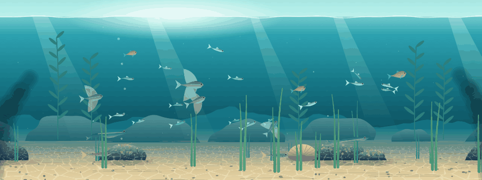

보는 사람이 물속에 들어가 있는 시점입니다. 수조 틀도 방도 없이 화면 전체가 물이고, 위쪽 가까이에 은빛 수면 선이 출렁입니다. 물빛은 밝은 청록에서 깊은 청록으로 3~4겹의 깊이 안개를 이루고, 수면에서 빛줄기가 비스듬히 내려오며, 햇빛 받은 모래 바닥에는 물결 빛 무늬가 일렁입니다.

| 차량 신호 | 아쿠아리움 |
|---|---|
| 차속 · 후진 | 물고기 떼의 순항 속도 (상한 있음) · 떼가 해초 사이로 뒤로 흐름 |
| 가속 · 급제동 | 위쪽의 수면 선과 해초가 기울어짐 (atan(a÷g), 최대 4°) · 한 번 휙 돌았다가 2초 안에 차분 |
| 깜빡이 | 선두 무리가 그쪽으로 천천히 |
| 공조 바람 · 에어컨 · 온도 | 왼쪽 바위 틈에서 오르는 기포의 수와 크기 · 물빛이 조금 차갑게/따뜻하게 |
| 와이퍼 · 밤 · 주행 모드 | 아래에서 본 수면의 빗방울 동심원 · 잉크빛 밤바다와 천천히 빛나는 플랑크톤 · 에코 초록빛 / 스포츠 노을빛 |
| 별 · 콤보 · 1km | 모래 위 가리비가 열리며 진주가 보임 · 물고기 떼가 원을 그림 · 모래 위 장식 하나 |
| 충전 · 도착 | 오른쪽 바위 틈에서 기포 기둥이 꾸준히 오르고 물이 조금 밝아짐 · 물고기들이 화면 가운데로 모임 |

- 물고기 6종(은빛 줄무늬떼, 동글노, 리본장어, 모래납작이, 돛지느러미, 꼬마청소새우)은 새로 만든 종입니다. 등은 어둡고 배는 밝은 그러데이션 몸에 8마디 척추와 몸통 파동을 넣어 헤엄칩니다.

### 궤도 테마: 1km = 한 바퀴

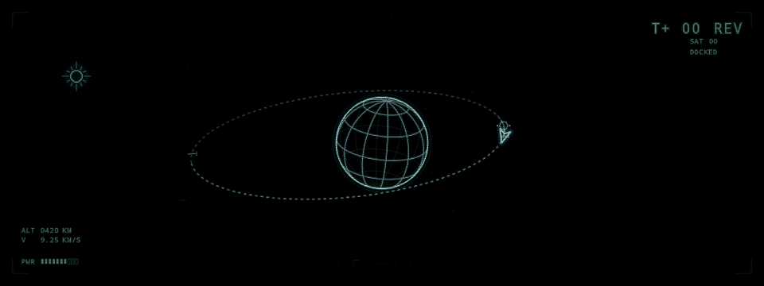

빛나는 벡터 형광 화면처럼 그렸습니다. 검은 바탕에 가는 형광 선과 은은한 번짐, 옅은 주사선이 있고, 행성은 위도·경도 선으로 된 와이어프레임 지구본, 궤도는 근점·원점 눈금이 있는 점선 타원, 우주선은 작은 갈매기표(셰브론) 모양입니다. 색은 청백색과 희미한 초록 두 가지뿐이고, 구석에 작은 고정폭 대문자 텔레메트리(`ALT`, `V`, `T+`)가 있습니다.

| 차량 신호 | 궤도 |
|---|---|
| 주행 거리 · 차속 | 우주선이 1km마다 행성을 한 바퀴 (120km/h에서 상한), 근점에서 더 빠르게. 지나온 궤도에 형광 잔상 |
| 후진 · P | 역행 궤도 · 근점 바로 바깥의 고리 정거장에 도킹 (`DOCKED`) |
| 가속 · 감속 · 깜빡이 · 급제동 | 뒤로 뻗는 추력 벡터 선 · 앞쪽 역추진 벡터 · 그쪽 자세 제어 눈금 · 한 번 살짝 흔들림 |
| 공조 바람 · 와이퍼 · 밤 | 희미한 초록 점선의 태양풍 · 2초에 하나 이하의 유성 한 줄 · 형광 선이 조금 어두워지고 우주선 앞에 작은 등 |
| 별 · 콤보 · 1km | 벡터 위성이 우주선에서 나와 제 궤도로 (케플러 제3법칙, 최대 12개) · 궤도 표시 24개가 차례로 켜져 고리가 완성됨 · 정거장 옆 바퀴 눈금 |
| 배터리 · 충전 | 구석 텔레메트리의 `PWR` 10칸 막대 (숫자 없음, 주차 중에만) · 우주선 양옆으로 초록 태양전지판이 펼쳐짐 |

- 주행 중에는 텔레메트리 가운데 바퀴 수 `T+ NN REV` 하나만 24sp 이상으로 남고, 나머지 작은 글자는 0.3초에 사라집니다.

### 구슬 장치 테마: 정거장마다 차의 조작이 연결된 기계

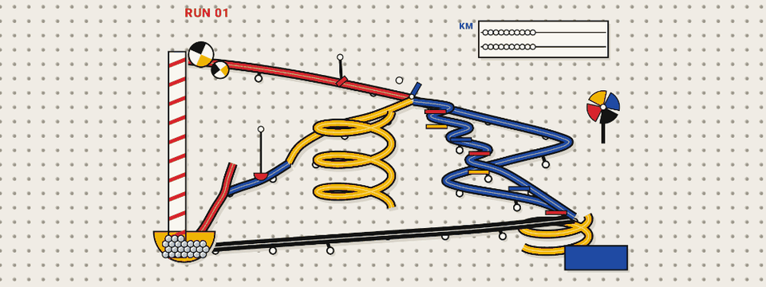

바우하우스 장난감처럼 그렸습니다. 흰 타공판(밤에는 남색) 위에 빨강·노랑·파랑 원색의 기하학 부품을 굵고 일정한 검은 테두리로 꽂아 레일을 만들었고, 구슬은 딱딱한 하이라이트 점 하나가 있는 유리 구슬입니다. 판 위에 `RUN 01`이 인쇄되어 있습니다. 나뭇결이나 금속 광택은 없습니다.

| 차량 신호 | 구슬 장치 |
|---|---|
| 차속 | 승강기가 구슬을 올림(흰 기둥 속 빨간 사선 띠가 나사처럼 올라감). 멈추면 호퍼에서 대기 |
| 브레이크 · 급제동 | 레버가 내려와 구슬이 줄지어 기다림 · 모든 정거장에 빨간 멈춤 핀 (1초) |
| 깜빡이 · 후진 | 갈림길 깃발이 그쪽 레일로(왼쪽 파랑, 오른쪽 빨강), 옆의 둥근 램프가 깜빡이 박자로 · 되돌이 고리 |
| 와이퍼 · 바람 · 에어컨 | 1.6초 주기 진자 컵(빨간 반원)이 구슬을 건네줌 · 사분원 날개 네 장의 바람개비 · 오른쪽 레일이 코발트 파랑으로 바뀜(빛나지 않음) |
| 밤 | 판이 남색으로 바뀌고 작은 둥근 노란 등이 켜짐 |
| 별 · 콤보 · 1km | 빨간 줄무늬 흰 구슬이 나선을 내려옴 · 1초 동안 갈림길·진자 컵·차임 막대·멈춤 핀이 모두 노랑으로 바뀌고, 줄무늬 구슬이 차임 사다리를 울림 · 주판알 하나 |
| 도착 · 충전 | 줄무늬 구슬은 오른쪽 아래 쟁반으로 · 노란 원판에 직사각형 빛살 여덟 개인 해 바퀴가 승강기를 천천히 |

| 줄무늬 구슬 출발 | 콤보: 모든 갈림길이 노랑으로 |
|---|---|
| 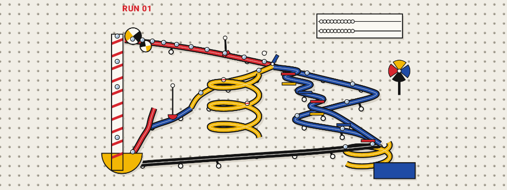 | 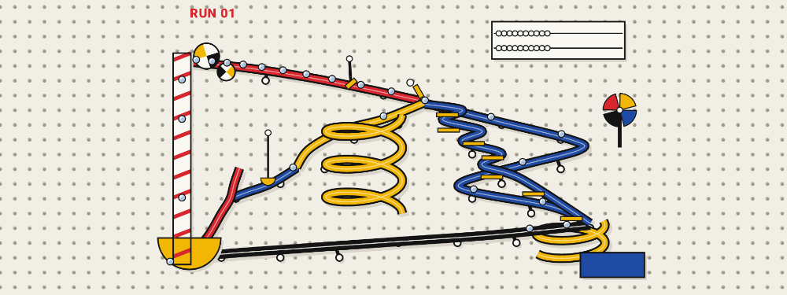 |

- 구슬은 레일(스플라인) 위에서만 1차원으로 구릅니다: a = (5 ÷ 7)·g·sinθ − c·v. 레일 위에서는 에너지가 늘지 않고, 보통 구슬 24개는 늘 그대로입니다(테스트로 확인).

### 종이 팝업북 테마: 리소 인쇄 팝업북 "POP-UP ROAD"

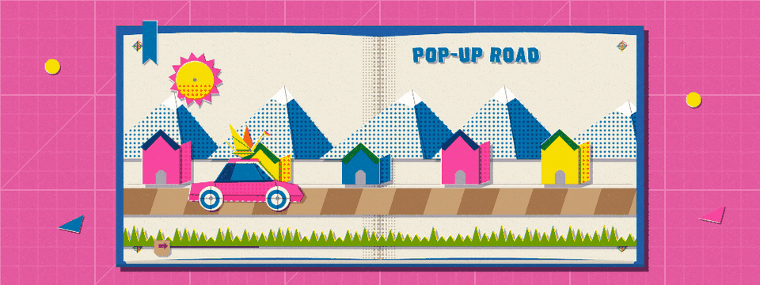

- 분홍 커팅 매트 위에 펼쳐진 팝업북입니다. 형광 분홍·파랑·노랑 세 가지 잉크로 찍은 리소 인쇄처럼 그렸고, 잉크마다 1~2단위씩 어긋나 겹친 곳은 다른 색이 되며, 그늘은 망점으로 냅니다. 오린 가장자리에는 흰 종이 심이 보이고, 접는 선에는 가는 주름 그늘이 있습니다. 제목 `POP-UP ROAD`는 살짝 기운 오려 낸 대문자입니다.
- 주인공은 면으로 접은 **종이접기 자동차**와 그 지붕에 탄 **종이학**입니다(얼굴·운전자 없음). 자동차는 크래프트지 길 띠 위를 달리고, 종이학은 깜빡이와 신나는 순간에 날개를 펄럭이고 브레이크를 밟으면 목을 접습니다. 급제동 때는 자동차가 뒷바퀴를 축으로 젖혀졌다 돌아오고 종이학이 흔들립니다(관절 25° 이내). 종이는 경첩으로만 움직이고, 늘어나거나 눌리지 않습니다.
- 풍경은 종이 산을 뒤에 두고 접은 종이 풍경으로 바뀝니다: 도시는 종이 집, 공원은 삼각형을 겹친 종이접기 나무, 들판은 아코디언 접기 밭과 바람개비, 바닷가는 아코디언 접기 강과 팝업 다리·종이배, 산은 접은 소나무와 바위. 새 풍경은 접힌 선에서 일어서고 이전 풍경은 뒤로 눕습니다.
- 차속은 책 아래 당김 탭(해 바퀴를 돌림), 깜빡이는 경첩으로 튀어나오는 종이 화살표, 와이퍼는 실에 매단 종이 빗방울, 에어컨은 실에 매단 종이 눈송이, 전조등은 노란 셀로판, 별은 여백에서 뒤집히며 날아와 오른쪽 쪽에 줄지어 앉는 **펀치로 뚫은 색종이 동그라미**, 콤보는 당김 탭으로 펼쳐지는 **종이 깃발 가랜드**, 1km는 리본 책갈피로 보여 줍니다. 밤에는 책상 램프 하나가 비추고 분홍 잉크가 보라로 바뀌며, 둥근 종이 별과 초승달이 실에 매달립니다.
- 책장 넘기기는 주차 중에만 되고, 도착하면 책이 덮여 파란 천 표지와 `POP-UP` 라벨이 보입니다.
- 브루미·친구·꼬마차·금색 별은 나오지 않습니다. 캐릭터가 없는 테마라 브루미 음성은 기본으로 꺼집니다(설정 > `캐릭터 없는 테마에서도 음성 안내`).

| 색종이 동그라미 (별) | 팝업 구조 | 종이학 |
|---|---|---|
| 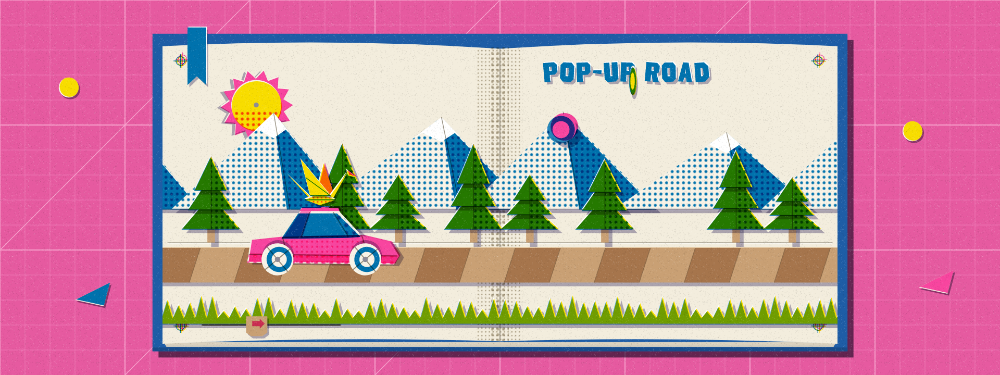 | 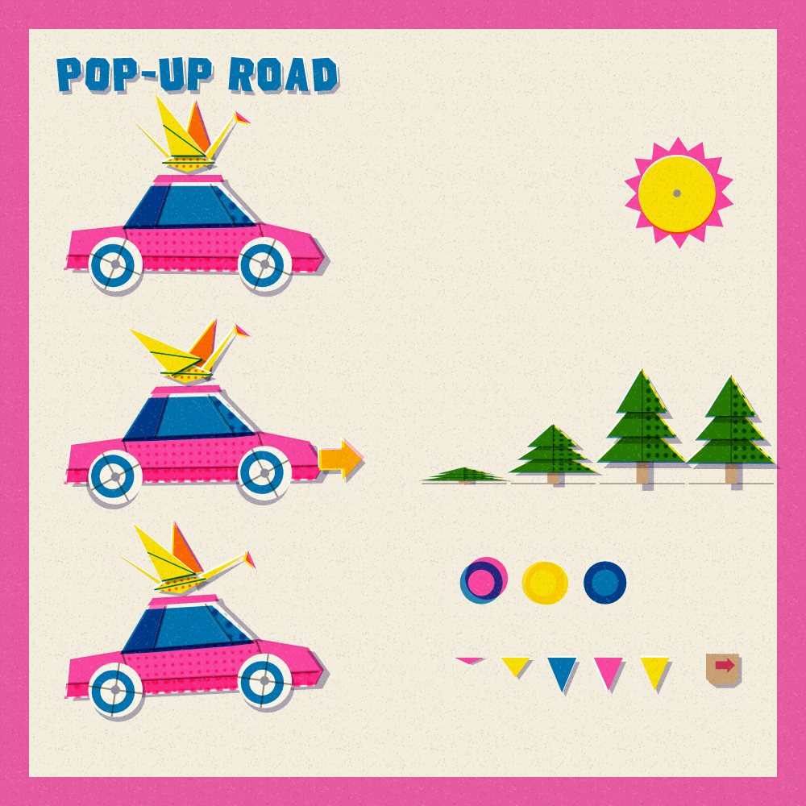 | 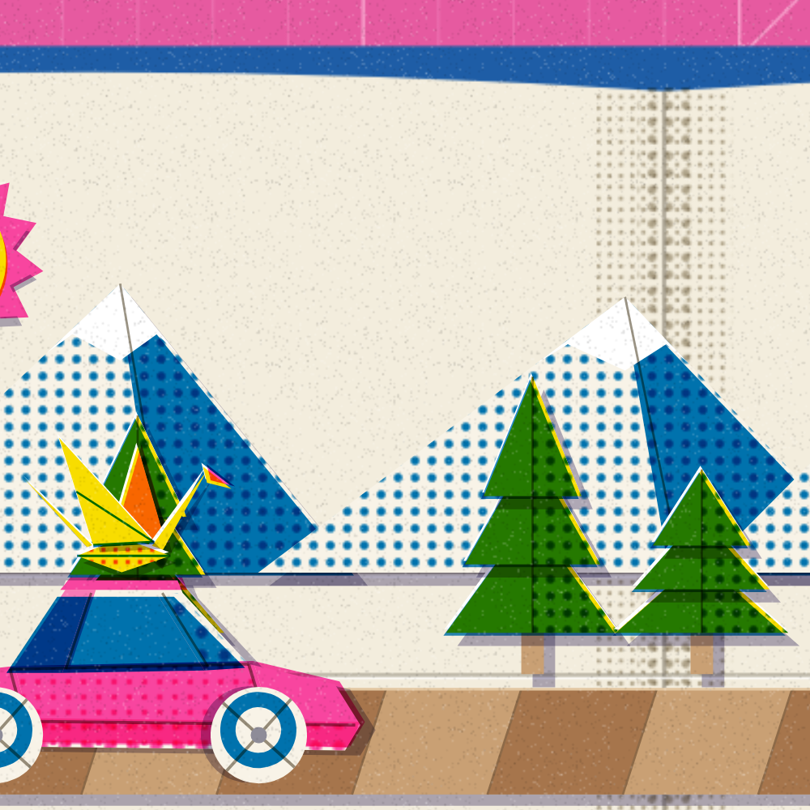 |

### 도트 월드 테마: 내 차가 플레이하는 8비트 길

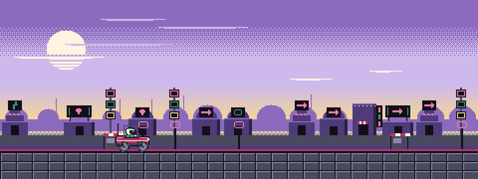

헬멧 쓴 작은 조종사가 커다란 바퀴의 네모난 도트 탐사차를 몰고, 옆으로 흐르는 오리지널 8비트 세계를 달립니다. 이 세계만의 16색 팔레트(땅거미 보라, 자홍, 청록빛 초록, 모래, 숯 검정)와 다섯 가지 타일 세트를 씁니다. **운전이 곧 플레이**지만 적·점수·목숨·제한 시간·스테이지 번호·게임오버는 없습니다. 빨리 달려도 보상이 늘지 않습니다.

| 차량 신호 | 도트 월드 |
|---|---|
| 차속 | 세계가 흐르는 속도 = 차속 × 2.4픽셀/초 (100km/h = 240픽셀/초, 120km/h부터는 같음). 5겹 시차 스크롤(정수 픽셀 단위) |
| 가속 · P/N | 배기 연기 퐁퐁 (초당 4번까지) · 조종사가 1초에 1픽셀 들썩 |
| 브레이크 · 급제동 | 브레이크등 · 화면이 2픽셀 한 번 흔들림(0.3초), 조종사 머리 위 "!", 길에 스키드 자국 |
| 깜빡이 · 비상등 · 후진 | 탐사차 깜빡이등과 길가 화살표 표지판(비상등은 양쪽 화살표) · 세계가 거꾸로 흐르고 후진등과 길 위 "<<" 표시 |
| 전조등 · 비 · 에코 · 스포츠 | **팔레트 교체**: 밤(초승달과 별, 네온 기둥·출입구·수정이 빛나고 도트 전조등 빛) · 비(보랏빛 회색 빗줄기·물웅덩이) · 에코(옅은 하늘, 바위와 흙이 청록빛 초록으로) · 스포츠(자홍·분홍 노을 하늘). 우선순위 밤 > 비 > 주행 모드 > 낮 |
| 서리 제거 · 바람 · 에어컨 · 크루즈 | 헬멧 바이저의 김이 아래부터 걷힘 · 안테나 바람개비가 풍량만큼 · 눈송이 도트 · 안테나 깃발 |
| 설정 온도 | 26℃ 이상: 먼 길 위 아지랑이(한 줄 걸러 1픽셀씩 어긋남) · 18℃ 이하: 헬멧과 탐사차 모서리에 서리 |
| 별 · 콤보 | 1.2초 앞에 마름모 테두리의 **보석 조각**이 돌며 나타나고, 탐사차가 깡충 뛰어 **뜀의 꼭대기에서** 잡음(짧은 도트 반짝임) → 왼쪽 위 보석 줄에 한 칸이 켜짐 (12칸, 다 차면 새 줄) / 콤보: 빛 한 칸이 보석 줄을 왼쪽에서 오른쪽으로 지나감 |
| 1km | 등불을 얹은 기둥 두 개가 "N KM" 현수막을 든 체크포인트가 지나가고 조종사가 환호 |
| 목적지 300m · 도착 | 저 앞에 둥근 지붕(반원통)의 격납고 → 들어가서 조종사가 내려 손을 흔들고 롤업 문이 내려옴 |
| 충전 · 배터리 부족 | 충전 기둥, 케이블, 5칸 도트 배터리(잔량을 모르면 칸 없이 기둥만) · 조종사 머리 위 분홍 배터리 |
| 문 열림 (주차 중) | 조종사가 몸을 내밀고 손을 흔듦 |
| 풍경 | 도시 → 네온 오락실 거리, 공원 → 소나무 능선, 들판 → 사막 고속도로(선인장), 바닷가 → 수정 동굴, 산 → 협곡 메사. 이미 보이는 칸은 그대로, 새로 나오는 칸부터 바뀜 |
| 주차 중 터치 | 탐사차가 깡충 뛰고 조종사가 손을 흔듦 (주행 중에는 반응하지 않음) |
| 안전 경고 | 다른 테마와 같이 오른쪽 위 구석으로 물러나고, 세계가 멈춘 채 70% 밝기 |

| 보석 조각 잡기 | 밤 팔레트 (협곡) | 비상등 · 아지랑이 |
|---|---|---|
| 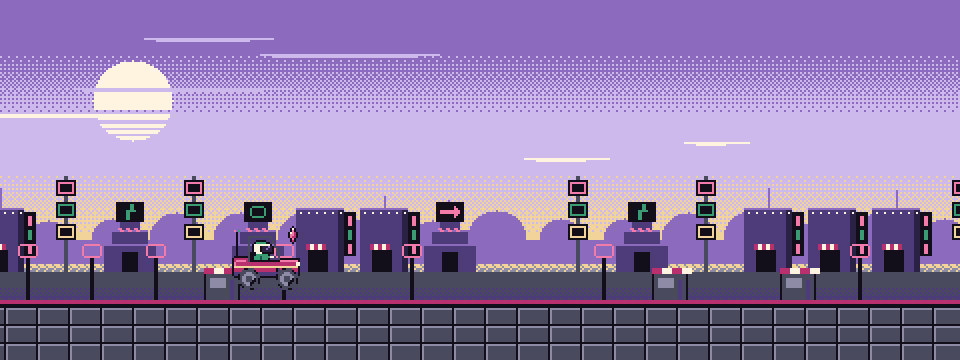 | 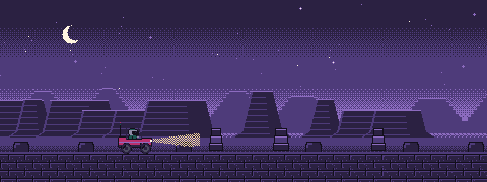 | 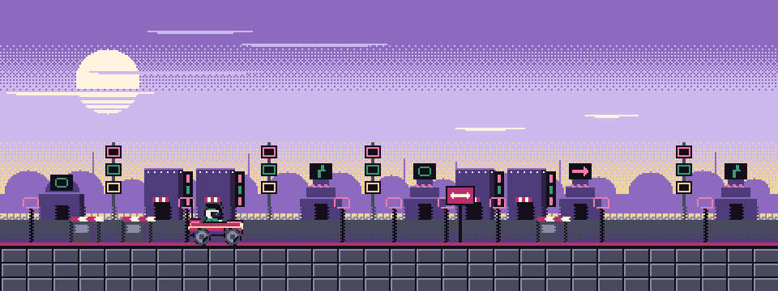 |

| 타일 세트 다섯 가지 (낮 · 밤) | 탐사차와 조종사 | 콤보: 보석 줄 |
|---|---|---|
| 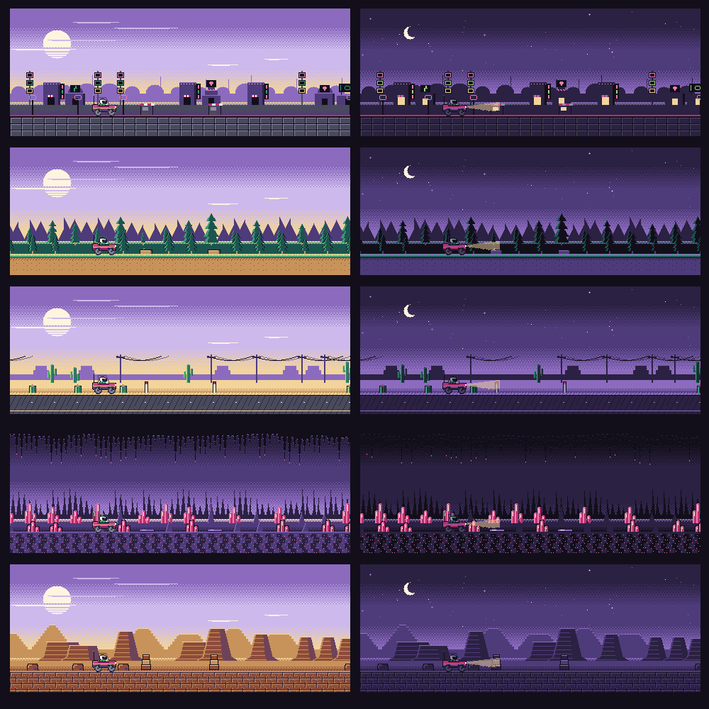 | 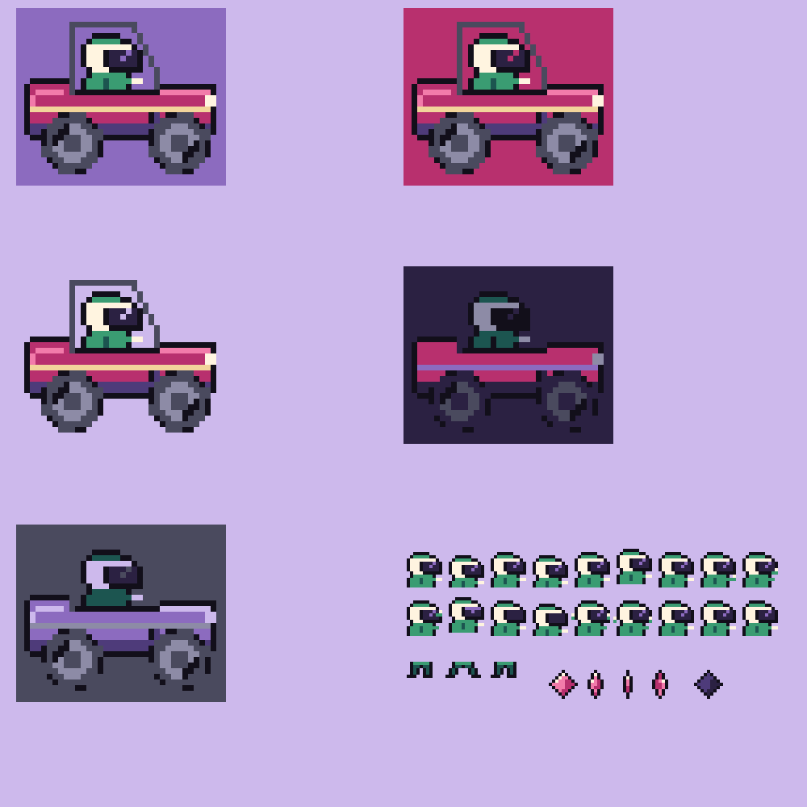 | 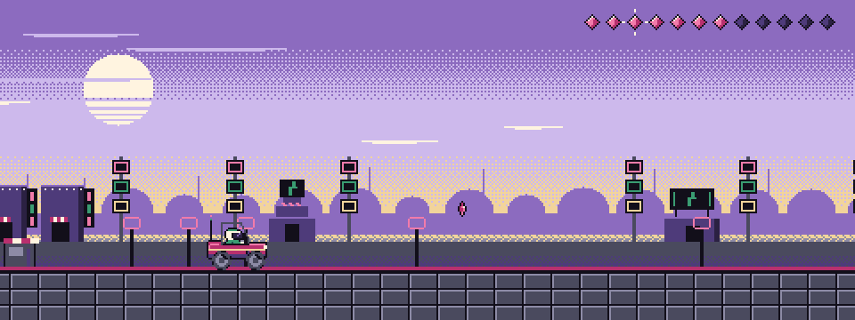 |

- **진짜 도트**: 480 × 180 가상 화면 하나에 모든 레이어를 그린 뒤 **정수 배율**로만 키웁니다(1920 × 720 화면 = 4배, 남는 곳은 하늘·도로 색으로 채움). 보간 없이 최근접 픽셀로 늘려서 픽셀이 번지지 않습니다.
- 탐사차(34픽셀 너비, 바퀴 11 × 11 회전 4프레임)와 조종사(12 × 12, 서 있을 때 다리 12 × 5)를 새로 그렸습니다. 조종사는 둥근 헬멧에 바이저만 있고 눈·귀가 없습니다(운전·대기·뜀·손 흔들기·놀람·졸림·기쁨·내리기 18프레임). 보석은 9 × 9, 글꼴은 5 × 7 오리지널이고, 장면 안의 글자는 숫자와 짧은 라틴 문자("N KM")뿐입니다.
- 팔레트는 고정된 16색 하나이고, 낮·노을·초원·밤·비 다섯 분위기는 같은 16색의 번호를 바꿔 끼운 것입니다. 그래서 밤은 어두운 막을 씌우는 게 아니라 **같은 그림의 색만 바꾼 것**입니다. 하늘은 4 × 4 디더로 이은 띠이고, 구름 대신 길고 납작한 층운이 흐릅니다. 스프라이트 애니메이션은 초당 12프레임 이하(차분 모드 6)이고 픽셀 사이를 보간하지 않습니다.
- 주행 중에 체크포인트의 "N KM" 글자가 화면에서 24sp보다 작게 보이면 그 글자는 사라집니다(디더 두 단계로 0.3초).
- "테마 소리"를 켜면 펄스 2채널·삼각파·노이즈로 만든 칩튠이 나옵니다(샘플 없음). 템포는 멈춤 80 · 50km/h 이하 100 · 그 이상 120이고 **마디가 바뀔 때만** 바뀝니다. 조는 풍경에 따라(오락실 거리 C, 소나무 능선 F, 사막 고속도로 G, 수정 동굴 D, 협곡 A단조) 바뀝니다. 곡과 효과음은 모두 오리지널입니다.
- 브루미·친구·꼬마차·별 조각은 나오지 않습니다. 캐릭터가 없는 테마라 브루미 음성은 기본으로 꺼집니다(설정 > `캐릭터 없는 테마에서도 음성 안내`).
- 데모: **도트 월드 쇼케이스 (1분 40초)**. 데모 동안만 도트 월드로 바뀝니다.
- 다른 게임과 닮지 않게 피한 것들은 [`docs/character-originality.md` 11장](docs/character-originality.md)에 정리했습니다.

## 3. 차량 신호 → 브루미 반응

| 차량 신호 (SDK) | 브루미와 꼬마차 |
|---|---|
| 기어 P → D (`Gear`) | 주차된 꼬마차에 폴짝 올라탐 / P단이면 내려서 옆에 섬 |
| 차속 (FusedLocation 위치 변화로 계산) | 길이 흐르는 속도, 바퀴 회전, 통통 튀는 정도, 110km/h 이상 속도선 (과속 보상 없음) |
| 부드럽고 힘찬 가속 (가속도 > 2 m/s², 0.4초 이상) | 앞바퀴가 살짝 들리고 등이 뒤로 눌림, 신난 얼굴, 전기 불꽃 슝 (EV라 연기 없음) |
| 브레이크 페달 (`Brake.registerBrakePedalStatus`) | 브레이크등 켜짐, 차 앞이 숙여지고 몸이 앞으로 쏠림 |
| 급제동 (가속도 < −3.5 m/s²) | 핸들에 콩 부딪히고 머리 위로 별이 빙글, 2초 어지러움 (꾸중 없음), 별 콤보 초기화 |
| 방향지시등 좌·우 (`TurnSignal`) | 꼬마차 깜빡이 점멸, 머리 위 ↰/↱ 표지판, 그쪽 손으로 가리키며 핸들을 돌림 |
| 풍량 ↑ (`HVAC.registerHvacFanSpeed`) | 볼을 빵빵하게 하고 바람을 붊, 귀(잎)와 깃발이 바람에 날림, 바람 입자 ∝ 풍량 |
| 설정 온도 ≤ 21°C / A/C / 최대 냉방 | 파란 입김, 눈송이, 앞유리에 옅은 성에, 오들오들 |
| 설정 온도 ≥ 26°C | 목도리가 바람에 펄럭, 따뜻한 김 |
| 서리 제거 | 뿌옇게 김 서린 앞유리를 천으로 쓱쓱 닦음 |
| 공기청정 / 내기순환 / 공조 AUTO | 반짝이 / 회오리 / 엄지척 |
| 와이퍼 | 우비, 비, 와이퍼 작동, 앞유리 빗방울, 젖은 도로 반사, 바퀴 물보라 |
| 전조등 | 밤하늘(별·달), 건물 창문 불빛, 가로등, 꼬마차 전조등 빛, 깃대 랜턴 |
| 크루즈 (`Cruise`) | 선글라스, 꼬마차 아래 은은한 하늘색 빛 |
| 에코 / 스포츠 모드 (`DriveMode`) | 초록 꼬마차 + 새싹 / 빨간 꼬마차 + 흰 줄무늬 + 고글 |
| 열선 시트 | 꼬마차 옆에 담요 |
| 후진 (R) | 길이 거꾸로 흐름 |
| 문 열림 (주차 중) | 인사 / 10분 안에 다시 열면 작별 인사 |
| EV 충전 / 배터리 15% 이하 | 충전기 케이블이 꼬마차에 연결, 에너지 냠냠, 배터리 아이콘 / 배고픈 표정, 천천히 숨 쉬는 배터리 아이콘 |
| 길안내 중 / 1km 이내 / 도착 (`NaviHelper`) | 지도 모자, 조용히 / 지평선의 목적지 깃발이 점점 커짐, 앞을 살핌 / 결승선 + 깃발 + 색종이 + 축하 점프 |
| 안전벨트 경고 (`Safety`) | 즉시 오른쪽 위 작은 원으로 물러나 멈춤, 무음 |

전체 규칙과 우선순위: [`CharacterDirector.kt`](character/src/main/java/io/vroomi/character/CharacterDirector.kt) · 별/풍경/km: [`JourneyTracker.kt`](character/src/main/java/io/vroomi/character/JourneyTracker.kt)

**운전 안전 규칙**: 주행 중 화면에는 상태 칩 1개(12자 이하)와 큰 버튼 2개(음소거·차분 모드)만 나옵니다(데모 중에는 "데모 끝내기"가 하나 더). 깜빡임은 1.5Hz의 부드러운 맥동이고 번쩍이는 효과는 없습니다. **차분 모드**를 켜면 배경이 멈추고 파티클과 혼자 노는 동작이 꺼지며 움직임이 절반으로 줄어듭니다. 시스템의 "애니메이션 삭제" 설정도 따릅니다. 말은 주행 중 2분에 한 번, 12음절 이하로만 하고, 길안내 중에는 하지 않습니다.

## 4. 구조

```
app/            화면(Compose), VroomiRuntime(연결·데모), 다이어리·우정 레벨, 설정, 시나리오 JSON
core/vehicle/   VehicleSignalProvider, PleosVehicleProvider(Vehicle SDK), 차속 소스 체인,
                SignalProcessor(필터·가속도), DrivingEventDetector, 시뮬레이터(+ 데모 자막), CarUxRestrictions
core/navi/      NaviBridge(NaviHelper SDK, 수신만)
core/voice/     VoiceDirector(말하기 규칙), Pleos TTS/STT 래퍼, 한국어 IntentParser
character/      CharacterDirector(규칙), JourneyTracker(별·풍경·km),
                CharacterSkin(친구 15종), calibre/ CalibreGeometry(기어비) · CalibreTime(시간) · CalibreMechanics(차 → 무브먼트),
                render/ SceneRuntime(애니메이션 상태), WorldPainter(하늘·풍경·도로), KartPainter(꼬마차),
                        VroomiPainter(공통 리그·표정·옷), SkinPainter(친구별 몸·부품),
                        Particles(파티클·스프링), VroomiScene(Compose),
                render/calibre/ CalibreFinishCache(정적 레이어 비트맵), CalibrePainter(움직이는 부품), CalibreDial, CalibreScene
                engine/ EngineGeometry(크랭크·밸브·점화순서) · Gearbox(가상 8단) · EngineModel · MotorModel · EngineMechanics(차 → 동력계)
                render/engine/ EngineLayers(정적 단면 비트맵), EnginePainter(움직이는 부품·정보 칸), EngineScene
docs/           기획서(02), 퍼미션, 주최 측 질문, 캐릭터 독창성, 영상 대본, 제출 체크리스트, 스크린샷
```

- 그림은 외부 이미지 없이 전부 코드로 그립니다(Compose Canvas). 그래서 APK가 작고, 저작권이 문제 될 요소가 없습니다. 프레임마다 객체를 새로 만들지 않도록 경로·파티클(220개 풀)을 재사용합니다.
- 위치 데이터는 기기 밖으로 나가지 않고 저장도 하지 않습니다. 풍경은 실제 위치가 아니라 달린 거리로 바뀝니다. 분석 SDK가 없습니다.

| 항목 | 값 |
|---|---|
| minSdk / target / compile | 28 / 34 / 34 |
| Gradle / AGP / Kotlin | 8.9 / 8.5.2 / 2.0.21 (Java 17) |
| Pleos SDK | Vehicle 2.3.2, FusedLocation 1.1.3, NaviHelper 3.0.5, TextToSpeech 3.3.1, SpeechToText 3.3.1 |
| SDK 저장소 | `https://nexus-playground.pleos.ai/repository/maven-releases/` |
| 단위 테스트 | `./gradlew testDebugUnitTest` (신호 필터, 주행 이벤트, 캐릭터 규칙, 별·풍경·km, 음성 쿨다운, 한국어 명령 34문장, 점수, 시나리오 8종 전체 재생, 칼리버 기어비·시간·로터·태엽·크로노·공조 쓰기 0회, 엔진 변속·슬라이더 크랭크·점화순서·슬로모션·연료 차단·회생·쓰기 0회, 장면·화면 렌더링) |
| 시나리오 상태 로그 | [`docs/scenario-logs/`](docs/scenario-logs/) (테스트 후 `app/build/scenario-logs/<id>.txt`) |

**빌드 플래그** (`gradle.properties`)

| 플래그 | 기본값 | 의미 |
|---|---|---|
| `vroomi.teamName` | `TEAMNAME` | APK 파일명의 팀명 |
| `vroomi.allowAaosSpeed` | `false` | AAOS 표준 차속(`PERF_VEHICLE_SPEED`) 사용. 주최 측 확인 후에만 `true` + 매니페스트에 `CAR_SPEED` 추가 |
| `vroomi.allowHvacControl` | `false` | 음성으로 실차 공조 제어. `CONTROL_CAR_CLIMATE` 승인 후에만 `true` + 매니페스트에 추가 |

퍼미션 전체 표: [`docs/permissions.md`](docs/permissions.md)

## 5. 스크린샷

| | |
|---|---|
|  | 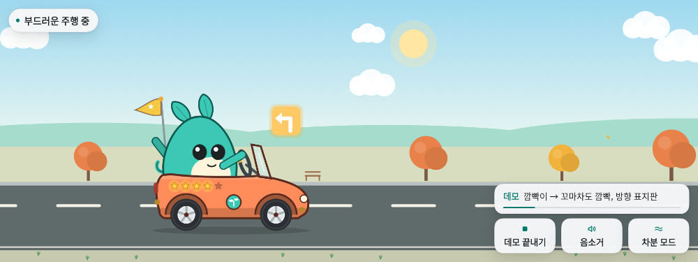 |
| 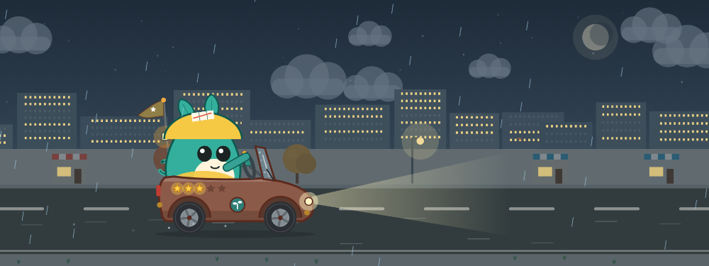 |  |
|  | 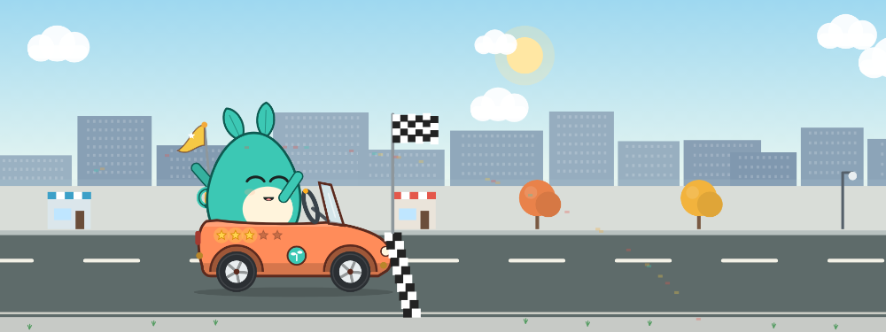 |
|  |  |

전체: [`docs/screenshots/`](docs/screenshots/)

## 6. 문서

- 기획서(접수양식 02, 1~8번): [`docs/proposal_02_ko.md`](docs/proposal_02_ko.md)
- 퍼미션 표: [`docs/permissions.md`](docs/permissions.md)
- 주최 측 문의 초안: [`docs/questions-to-organizers.md`](docs/questions-to-organizers.md)
- 캐릭터 독창성 검토: [`docs/character-originality.md`](docs/character-originality.md)
- 시연 영상 대본: [`docs/demo-video-script.md`](docs/demo-video-script.md) · 숏폼 대본: [`docs/shortform-script.md`](docs/shortform-script.md)
- 제출 체크리스트: [`docs/submission-checklist.md`](docs/submission-checklist.md)
- 오픈소스 고지: [`THIRD_PARTY_NOTICES.md`](THIRD_PARTY_NOTICES.md) · 라이선스: [`LICENSE`](LICENSE)
