# 02 앱 프로젝트 소개 / 심사 자료

> 접수양식(contest-application-consent.docx) 02 페이지에 들어가는 원고입니다.
> 이 페이지에는 대표자·구성원의 성명, 연락처, 이메일, 소속을 적지 않습니다. 개인정보는 01 참가신청서에만 씁니다.
> 수치는 2026-11-14 기준입니다(v1.7.0-contest).

**앱명 / 프로젝트명:** 위드라이빙 (WithDriving) — 내 운전으로 살아 움직이는 차 안의 작은 세계

---

## 1. 앱 한 줄 소개

가속·브레이크·깜빡이·에어컨 같은 내 운전 조작에 화면 속 세계가 똑같이 반응하고, 부드럽게 달릴수록 그 세계가 자라는 차량용 동승 앱

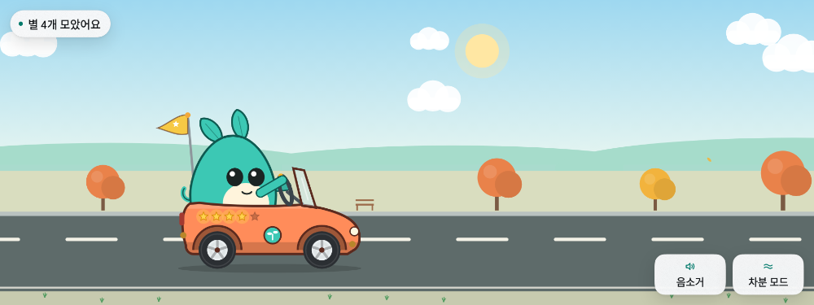

---

## 2. 기획 배경

**주목한 순간**

- **혼자 하는 출퇴근은 길고 단조롭습니다.** 매일 같은 길, 같은 정체 구간에서 운전자는 라디오나 내비 음성 말고는 대화 상대가 없습니다.
- **인포테인먼트 화면은 기능은 많지만 감정이 없습니다.** 지도, 미디어, 공조 버튼은 도구일 뿐이라, 차가 내 행동에 반응한다는 느낌을 주지 못합니다.
- **장거리 가족 이동에서는 뒷좌석 아이가 금방 지루해합니다.** 아이가 보채면 운전자도 지치고 주의가 흐트러집니다.
- **안전운전 앱은 잔소리처럼 느껴집니다.** 점수를 깎고 경고만 하는 방식은 금방 지워집니다. 부드러운 운전을 하고 싶게 만드는 보상이 없습니다.

**인사이트**

차가 하는 일에 실시간으로 반응하는 작은 세계가 있으면, 운전이 "혼자 하는 일"에서 "같이 하는 일"이 됩니다. 브레이크를 부드럽게 밟을수록 그 세계가 자란다면, 안전운전은 잔소리가 아니라 그 자체로 보상이 됩니다.

**왜 차여야 하는가**

페달, 브레이크, 에어컨 풍량, 방향지시등, 와이퍼는 오직 차만 알고 있습니다. 스마트폰 앱은 이 순간을 느낄 수 없습니다. 위드라이빙은 Pleos Connect가 차량 신호를 앱에 열어 주기 때문에 가능한 경험입니다.

---

## 3. 앱 주요 기능 및 차량 특화 요소

### ① 내 차를 따라 운전하는 동승 캐릭터 "브루미" (핵심)

브루미는 대시보드 안에 사는 오리지널 캐릭터입니다(민트색 달걀형 몸, 머리 위 나뭇잎 돛 2개). 주차 중에는 자기 **꼬마 전기차** 옆에 서 있다가, 기어를 D에 넣으면 폴짝 올라타 화면 속 길을 같이 달립니다. 꼬마차는 내 차를 그대로 따라 합니다. **운전자와 브루미가 나란히 운전하는** 구조입니다. 그림은 외부 이미지 없이 모두 코드로 그립니다.

| 차량에서 일어나는 일 (Pleos SDK) | 브루미와 꼬마차의 반응 |
|---|---|
| 기어 P ↔ D (Vehicle `Gear`) | 꼬마차에 폴짝 올라탐 / 내려서 옆에 섬 |
| 속도 (FusedLocation 기반 차속) | 길이 속도만큼 흐르고 바퀴가 돎. **110km/h 이상은 더 빨라지지 않음** (과속 보상 없음) |
| 부드럽고 힘찬 가속 | 꼬마차 앞이 살짝 들리고 전기 불꽃 슝, "부드럽다~" |
| 브레이크 페달 (Vehicle `Brake`) | 브레이크등이 켜지고 몸이 앞으로 쏠림 |
| 급제동 | 핸들에 콩, 머리 위로 별이 빙글, "어지러워요~" (꾸중 없음) |
| 방향지시등 (Vehicle `TurnSignal`) | 꼬마차 깜빡이, 머리 위 ↰/↱ 표지판, 그쪽을 가리키며 핸들을 돌림 |
| 에어컨 풍량 (Vehicle `HVAC`) | **볼을 빵빵하게 하고 바람을 불어 줌**. 풍량이 셀수록 바람 입자가 많고 빠름 |
| 설정 온도 21°C 이하 / 26°C 이상 | 파란 입김과 눈송이 / 목도리가 펄럭이고 김이 모락모락 |
| 서리 제거·공기청정·내기순환·AUTO | 김 서린 앞유리를 천으로 쓱쓱 · 반짝이 · 회오리 · 엄지척 |
| 와이퍼 / 전조등 | 노란 우비와 빗방울, 바퀴 물보라 / 밤하늘과 가로등, 꼬마차 전조등 |
| 크루즈 · 에코/스포츠 모드 · 시트 열선 | 선글라스 · 초록 꼬마차와 새싹 / 빨간 꼬마차와 고글 · 담요 |
| 문 열림 (주차 중) | "안녕하세요!" / 주행 후 "또 만나요!" |
| EV 충전 · 배터리 15% 이하 | 충전기 케이블이 꼬마차에 연결되고 에너지 냠냠 · 배고픈 표정 |
| 길안내 중 · 1km 이내 · 도착 (NaviHelper) | 조용히 지도 모자 · 지평선의 목적지 깃발 · 결승선과 축하 점프 |
| 차 안에서 음악이 재생됨 | 콧노래로 따라 부르고 머리 위로 음표 |
| 안전벨트 경고 (Vehicle `Safety`) | **즉시 구석의 작은 원으로 물러나 멈추며 무음** |

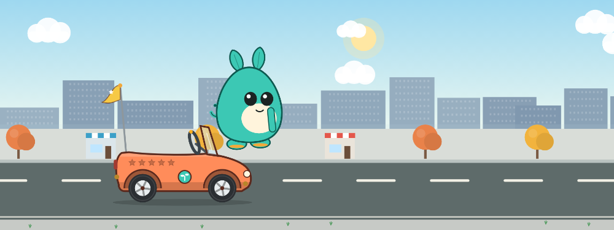 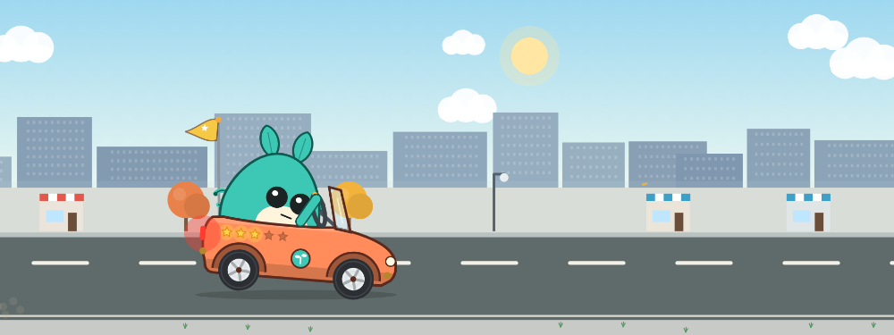 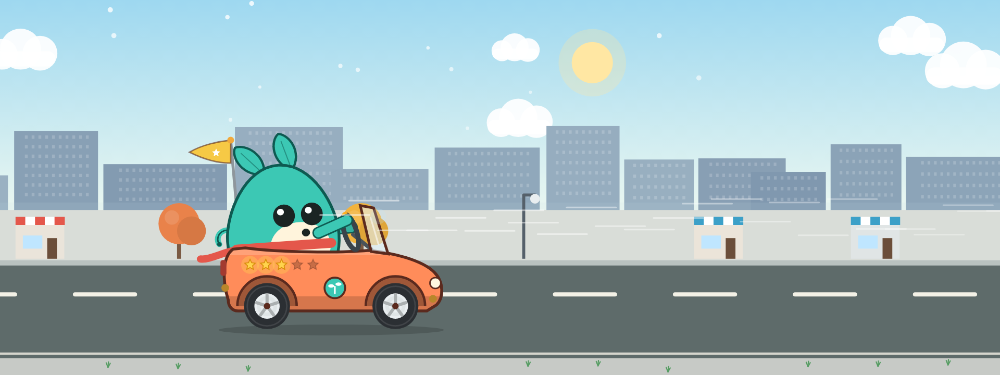

### ② 운전하는 내내 이어지는 장면

신호가 바뀔 때만 움직이는 캐릭터는 금방 정지 화면처럼 느껴집니다. 그래서 주행하는 동안 화면이 **한순간도 멈춰 있지 않게** 했습니다.

- **흘러가는 길**: 하늘·원경·가로변·도로·풀숲 5겹이 서로 다른 속도로 흐릅니다.
- **바뀌는 풍경**: 800m마다 도시 → 가로수길 → 들판 → 바닷가 → 산길로 바뀝니다. 실제 위치가 아니라 **달린 거리**로 바뀌므로 위치 정보를 쓰지 않습니다.
- **실제 시각과 계절**: 하늘과 해의 위치가 실제 시각을 따르고, 가로수는 계절색입니다.
- **별 모으기**: 급제동·급가속 없이 250m를 달릴 때마다 별이 날아와 브루미가 받습니다. 5개가 이어지면 콤보입니다. 과속 중에는 별이 나오지 않습니다. 부드러운 운전이 **눈에 보이는 보상**이 됩니다.
- **혼자 노는 동작**: 5~11초마다 손 흔들기, 하늘 보기, 핸들 두드리기 같은 몸짓을 합니다. 신호 대기 중에도 이어집니다. 손을 들 때도 다른 한 손은 늘 핸들 위에 둡니다.

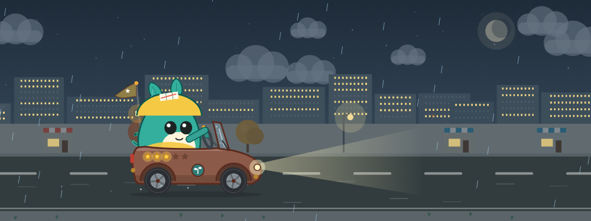 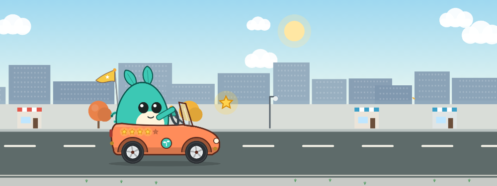 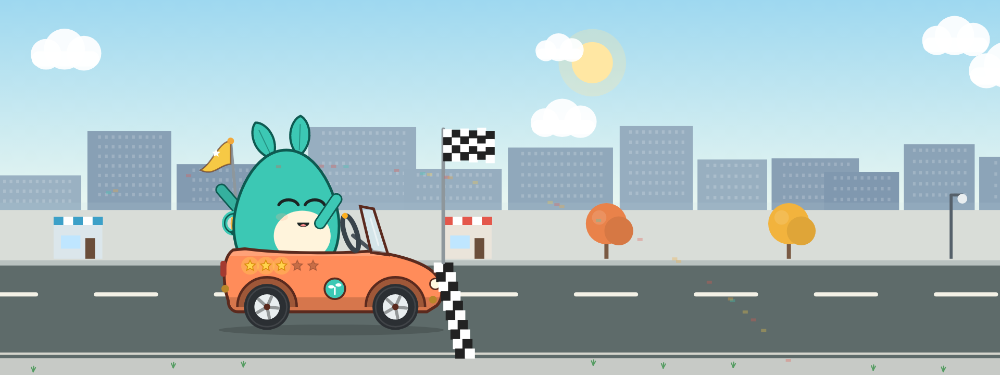

### ③ 같은 운전, 열두 가지 세계 (테마 12종)

같은 차량 신호를 **열두 가지 세계의 언어**로 바꿔 보여 줍니다. 꼬마차만 브루미의 세계이고, 나머지 열한 테마는 그림 기법·색·주인공·보상이 서로 다른 독립된 세계입니다. 신호마다 무엇이 반응하는지와 안전 규칙은 모든 테마가 같습니다. 테마 12개는 처음부터 모두 고를 수 있습니다.

| 테마 | 그 세계에서 운전이 뜻하는 것 (차량특화 포인트) |
|---|---|
| 꼬마차와 친구들 | 브루미가 자기 꼬마차로 내 차를 그대로 따라 운전. 같이 탈 친구 15종 |
| 오토매틱 시계 | 차속이 로터(진동추)를 돌리고, 에어컨 바람이 크라운을 돌려 태엽을 감음. 깜빡이는 해머가 공을 침. 출발·주차는 크로노그래프 시작·정지 |
| 엔진룸 | 차속·기어·주행 모드가 가상 변속기를 거쳐 엔진 단면의 피스톤·밸브·터보를 돌림. 전기차에서는 모터·인버터·배터리로 바뀌고, 브레이크를 밟으면 전력이 거꾸로 흐름(회생 제동) |
| 오르골 | 차속 = 템포, 달린 거리 = 태엽. 주차하면 감긴 태엽으로 혼자 연주 |
| 플라즈마 | 차속 = 보랏빛 전류 가닥 수(110km/h에서 더 늘지 않음), 깜빡이 쪽으로 가닥이 모임 |
| 로봇 격납고 | 실제 주행 30km마다 로봇 한 기체가 조립됨. 빨리 달려도 거리만큼만 조립 |
| 유리병 정원 | 1km마다 자라고 다음 여행에도 남음. 5분 부드러운 주행 = 꽃 |
| 아쿠아리움 | 가속만큼 수면이 기울고, 깜빡이 쪽으로 물고기 떼가 돎 |
| 작은 태양계 | 1km = 한 바퀴, 후진 = 역행 궤도, P단 = 도킹 |
| 보물지도 | 지나온 길만 해도에 새김. 좌표는 저장하지 않음 |
| 종이 팝업북 | 종이접기 자동차와 종이학이 달리는 팝업북. 책장은 주차 중에만 넘김 |
| 도트 월드 | 내 차의 조작이 곧 플레이인 8비트 길. 적·점수·게임오버 없음 |

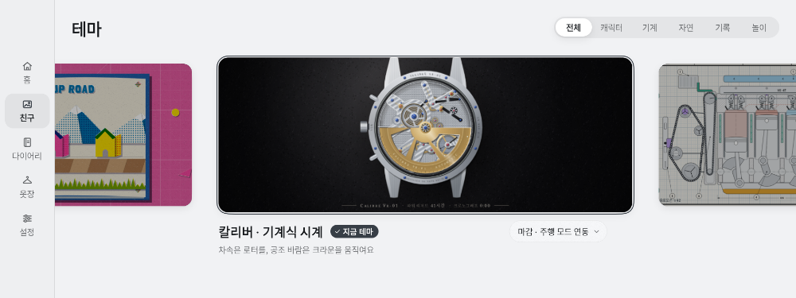 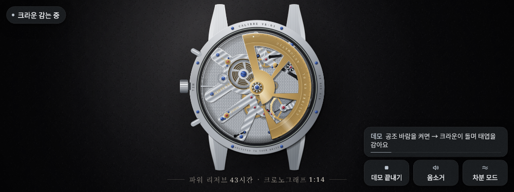 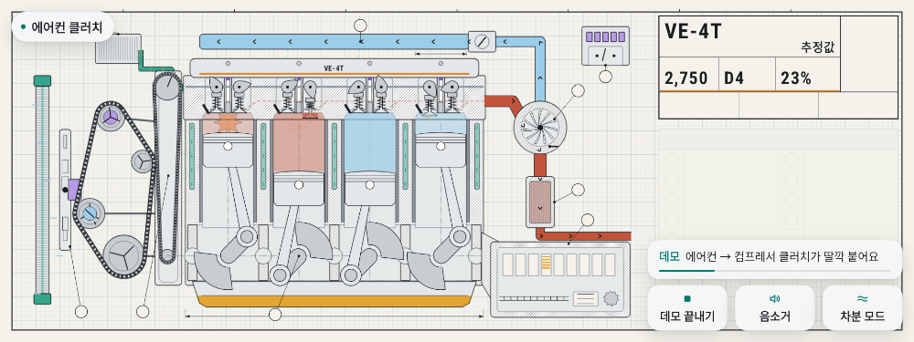

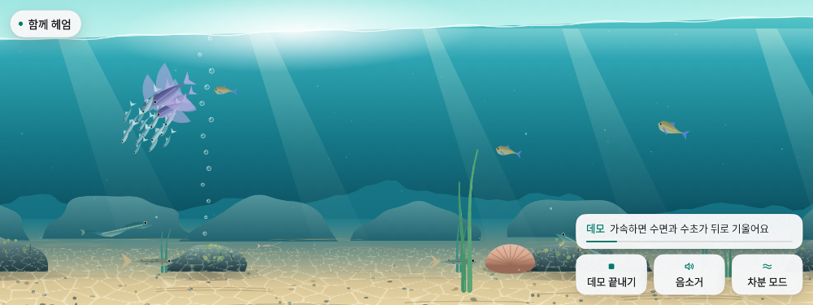 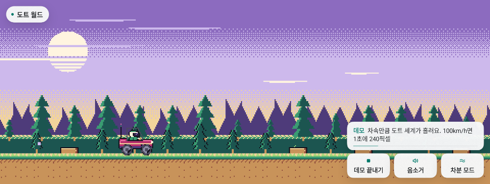 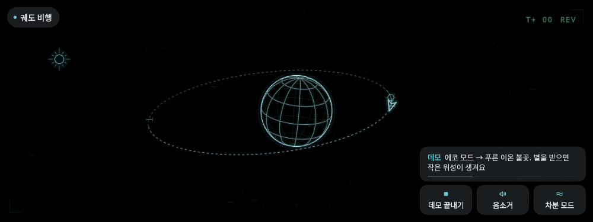

- **시계와 엔진은 오리지널 설계입니다.** 시계 무브먼트(Calibre VR-01)와 엔진(VE-4T)·모터(VE-M1)는 직접 설계했고, 어떤 브랜드의 모양도 쓰지 않았습니다.
- **추정과 실측을 구분합니다.** Vehicle SDK의 공개 API에는 엔진 회전수·모터 출력이 없어, 엔진룸 화면의 숫자는 모두 "추정"이라고 표시합니다. 앱이 알 수 없는 냉각수 온도·고장 코드·경고등 모양은 그리지 않아, 진짜 차량 경고와 헷갈릴 일이 없습니다.
- **차에는 아무것도 쓰지 않습니다.** 공조를 포함한 모든 차량 신호는 읽기만 하며, 테마마다 "차량 쓰기 0회"를 테스트로 확인합니다.

### ④ 안전운전 등급: 부드럽게 달릴수록 세계가 자란다

부드럽게 달린 기록이 다섯 등급이 되고, 등급이 오르면 **모든 테마의 다음 단계**가 열립니다.

| 등급 | 안전 거리 | 최근 안전 점수 | 열리는 것 |
|---|---|---|---|
| 브론즈 | 처음부터 | 없음 | 모든 테마 Lv.1, 색상 1종 |
| 실버 | 10km | 75점 | Lv.2, 색상 2종, 소품 1개 |
| 골드 | 30km | 80점 | Lv.3, 색상 3종, 소품 2개 |
| 플래티넘 | 60km | 85점 | Lv.4, 색상 4종, 소품 3개 |
| 다이아몬드 | 100km | 90점 | Lv.5, 색상 5종 |

- **안전 거리**는 부드러움 점수 70점 이상인 실제 주행의 거리 합이고, **최근 안전 점수**는 최근 주행 10회의 거리 가중 평균입니다. 둘 다 채워야 등급이 오릅니다.
- **빨리 달려도 오르지 않습니다.** 거리와 부드러움만 세고, 데모 주행은 세지 않습니다.
- **한 번 오른 등급은 내려가지 않습니다.** 벌처럼 느껴지지 않게 했습니다.
- 단계는 테마마다 이전 단계 위에 새 것이 더해지는 사다리입니다. 예: 시계는 스틸 → 투르비용, 엔진은 SOHC → 레이스 엔진, 격납고는 로봇 다섯 기체, 유리병 정원은 작은 병 → 온실 돔. 꼬마차를 뺀 11개 테마에는 등급으로 여는 **색상 5종**과 **소품 3개**가 더 있습니다.

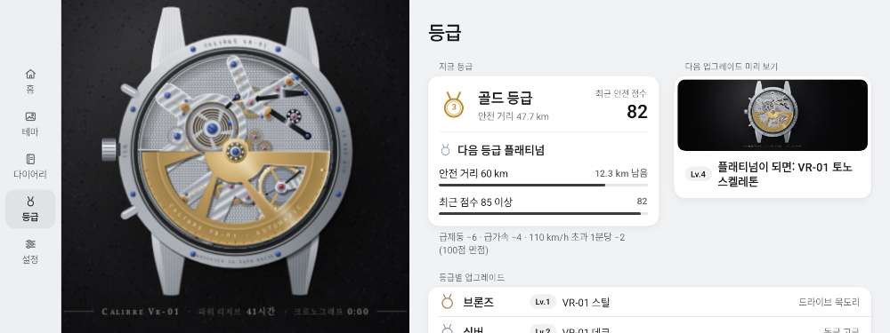 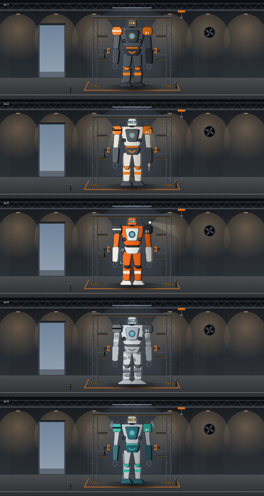

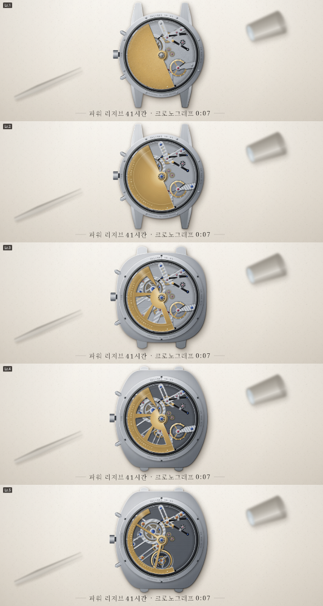 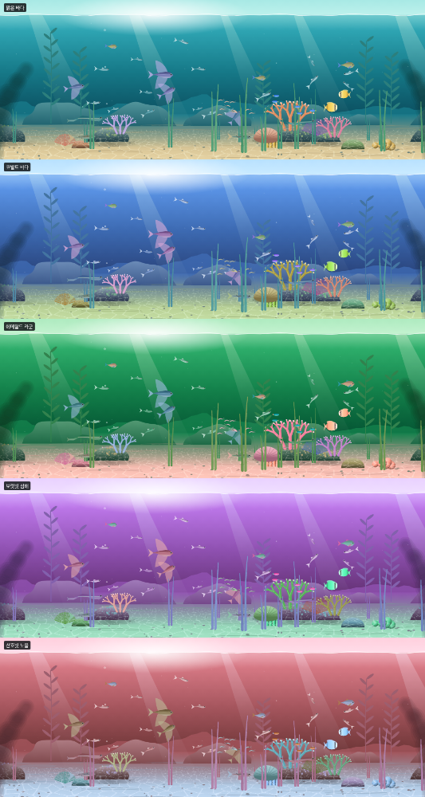

### ⑤ 꾸중 없는 운전 피드백과 다이어리

급가속·급제동·과속 시간을 세어 주행마다 "부드러움 점수"(0~100)를 매깁니다. 점수는 **주행 중에는 보여 주지 않고** 주차 후에만 보여 줍니다. 거친 운전에는 브루미가 코믹하게 어지러워할 뿐, 경고음이나 빨간 글씨가 없습니다. 주차하면 **오늘의 드라이브** 카드(점수·모은 별·거리·지나온 풍경)가 뜨고 다이어리에 기록이 남습니다.

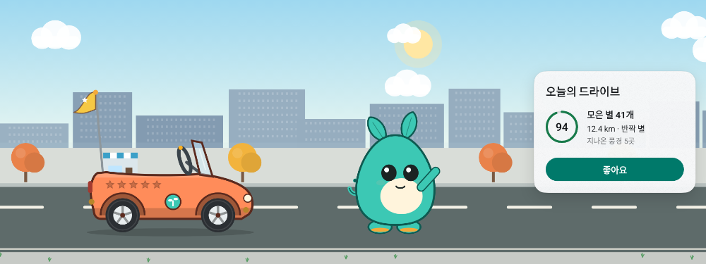 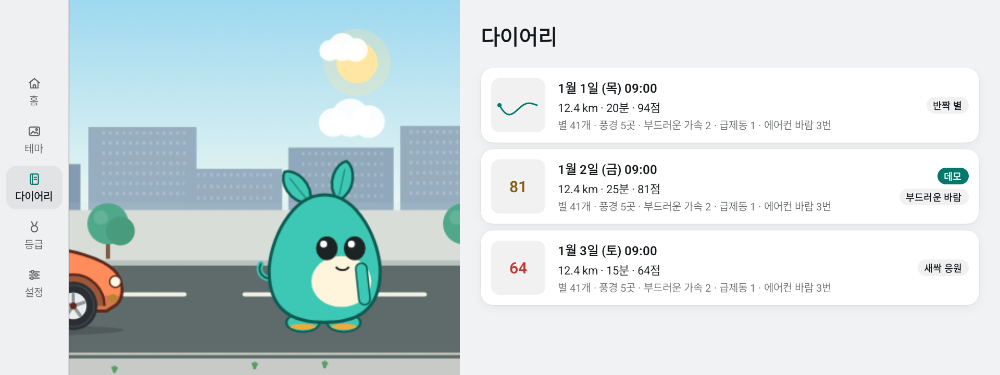

### ⑥ 음성 친구 (TextToSpeech · SpeechToText)

브루미는 Pleos TextToSpeech로 짧게 말합니다. 주행 중에는 **2분에 한 마디, 12음절 이하**로만 말하고, 길안내 음성이나 안전 경고가 있으면 침묵합니다. 주차 중에는 Pleos SpeechToText로 "시원하게 해줘", "오늘 얼마나 달렸어?" 같은 말을 알아듣습니다(기기 안에서 규칙 기반으로 해석, 차량 마이크 음성을 외부로 보내지 않음). 공조 제어는 켜지 않았고 "직접 조절해 주세요~"라고 답합니다.

### ⑦ 음악이 나오면 같이 듣는다

차 안에서 다른 앱이 음악을 재생하면 장면이 반응합니다. 브루미는 콧노래로 따라 부르고, 다른 테마는 음표를 띄우며 박자에 맞춰 움직입니다. 음악은 주행 내내 켜 두는 경우가 많으므로, 처음 12초쯤 뒤에는 움직임이 절반으로 잦아듭니다.

- 안드로이드의 공개 재생 상태 콜백만 씁니다. **퍼미션이 필요 없고**, 앱은 "지금 재생 중인지"만 압니다. 곡 제목이나 어떤 앱인지는 알 수 없습니다.
- 말소리(길안내·TTS)와 알림음은 음악으로 세지 않습니다.
- Pleos Connect 에뮬레이터에서 실제 음악을 재생해, 재생하면 반응하고 일시정지하면 멈추는 것을 확인했습니다.

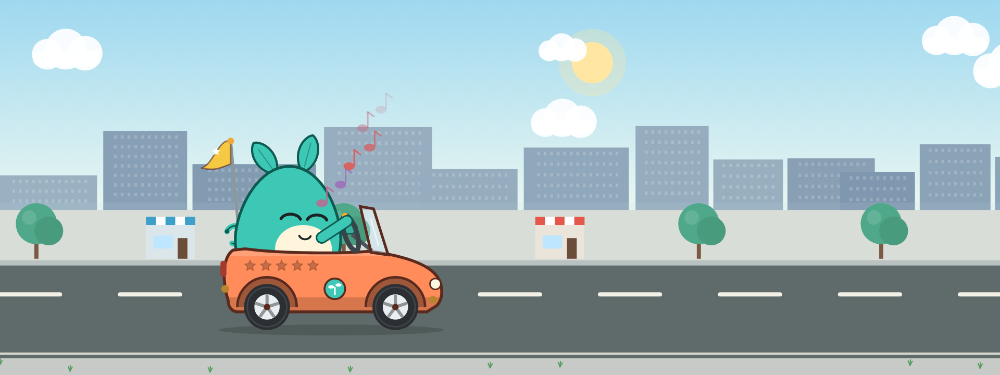 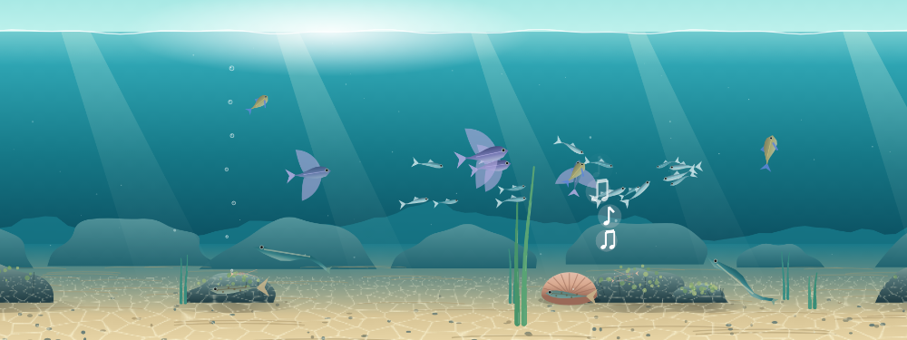

### ⑧ 데모 드라이브 (에뮬레이터·PT·전시용)

실차 없이도 모든 반응을 볼 수 있습니다. 첫 실행 소개 카드의 **데모 드라이브 보기**를 누르면 3분짜리 하이라이트가 시작됩니다.

- **직접 조작해 보기**: 가상의 차가 스스로 달리는 동안 화면 아래 버튼(가속, 브레이크, 깜빡이, 전조등, 와이퍼, 바람, 에어컨, 주행 모드, 음악 등)을 직접 누릅니다. 누를 때마다 테마가 바로 반응합니다.
- **한눈에 보기 / 조작별로 보기**: 테마마다 쇼케이스와 30초~1분 30초짜리 조작별 데모가 있습니다.
- 데모 중에는 화면에 "왼쪽 깜빡이 → 물고기 떼가 왼쪽으로"처럼 **내 조작 → 테마의 반응**이 자막으로 나옵니다.
- 데모 기록은 다이어리에 "데모"로 표시되고 등급에는 반영되지 않습니다. 실제 차가 움직여 운전자 주의 제한이 걸리면 데모는 바로 멈춥니다.

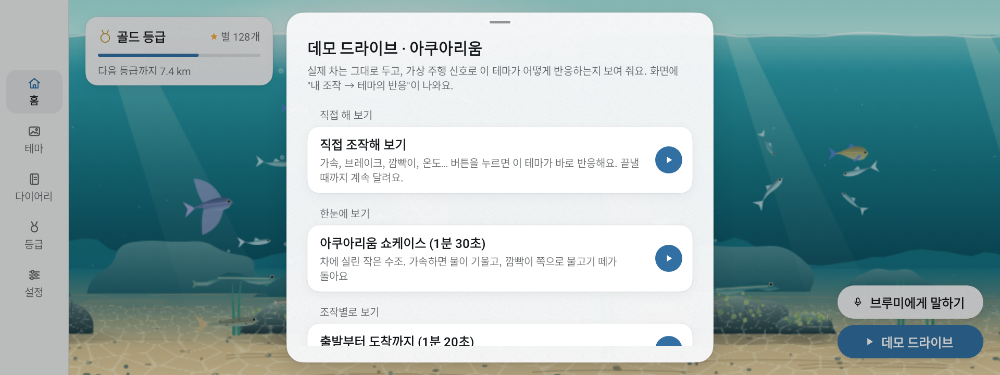 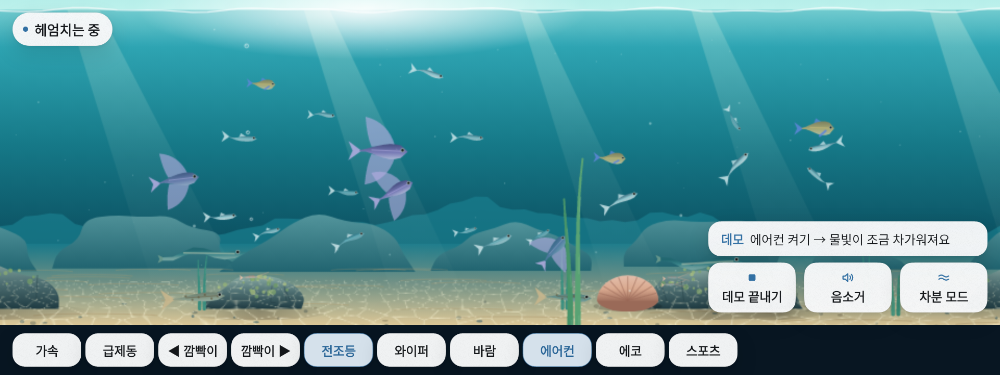

### ⑨ 운전 안전을 먼저 생각한 화면

- **주행 중**: 장면 + 12자 이하 상태 문구 1개 + 큰 버튼 2개(음소거, 차분 모드)만 보입니다. 목록, 키보드, 팝업, 영상이 없습니다. 한 번 흘끗 보면 충분한 화면입니다.
- **주차 중**(P단): 홈·테마·다이어리·등급·설정 탭이 열립니다. 신호 대기(D단 정차) 중에는 메뉴가 열리지 않습니다.
- AAOS `CarUxRestrictionsManager`를 따릅니다. 3Hz 이상 깜빡임, 화면 전체 번쩍임, 갑작스러운 큰 소리가 없습니다. 테마 12개 사이의 전환 132가지 모두에서 번쩍임이 없는지 계산으로 검사합니다.
- **안전 경고가 뜨면** 모든 테마가 구석으로 물러나 멈추고 어두워집니다.
- **속도로 보상하지 않습니다.** 110km/h 이상은 어떤 테마도 더 화려해지지 않습니다.
- **차분 모드**는 배경을 멈추고 움직임을 절반으로 줄입니다. 시스템의 "애니메이션 삭제" 설정도 따릅니다.
- 위치 데이터는 기기 밖으로 나가지 않고 좌표를 저장하지 않습니다. 분석 SDK가 없습니다.

### ⑩ 정돈된 인터페이스와 테마 전환

테마를 고르고, 미리 보고, 적용하고, 주행으로 넘어가는 모든 순간이 끊기지 않고 이어집니다. 지금 장면은 하나의 살아 있는 창이라 홈·탭·갤러리 사이를 옮겨 다녀도 다시 시작하지 않습니다. 주행 중에는 불투명도만 바뀌고, 버튼은 미끄러지지 않고 제자리에서 나타납니다. 앱 버튼은 왼쪽 위(상태)와 오른쪽 아래(동작) 두 구석에만 놓이고, 화면 비율이 달라져도(가로로 긴 화면, 세로로 긴 창) 장면이 그 구석을 피해 그려집니다.

### 모바일 앱과의 차이 (차량특화성)

스마트폰 캐릭터 앱은 사용자가 화면을 만질 때만 반응합니다. 위드라이빙은 **운전자가 원래 하던 행동, 즉 가속·제동·공조·깜빡이·와이퍼 조작 자체가 입력**입니다. 운전자는 추가로 아무것도 하지 않아도 되고, 화면을 볼 필요도 없습니다. 흘끗 봤을 때 내 운전을 따라 움직이는 세계가 있을 뿐입니다. 주행 중·정차 중·주차 중·충전 중이라는 차의 맥락이 곧 이 앱의 상태이며, 이것은 차 밖에서는 재현할 수 없는 경험입니다.

---

## 4. 주요 사용 시나리오

### ① 30대 직장인의 출근길 (혼자 운전, 꼬마차 테마)

| 상황 | 차량 신호 | 화면의 반응 | 사용자가 느끼는 가치 |
|---|---|---|---|
| 차에 타며 문을 연다 | 문 열림, P단 | 브루미가 손을 흔들며 "안녕하세요!" | 하루를 같이 시작하는 친구 |
| D단을 넣는다 | 기어 D | 꼬마차에 폴짝 올라타 핸들을 잡음 | "오늘도 같이 가는구나" |
| 부드럽게 출발 | 차속 상승 | 꼬마차 앞이 들리고 전기 불꽃, "부드럽다~" | 칭찬받는 운전 |
| 정체 구간, 브레이크 반복 | 브레이크 페달 | 브레이크등과 함께 앞으로 쏠림, 신호 대기 중엔 돌아보며 손 흔들기 | 지루한 정체 속 작은 웃음 |
| 음악을 튼다 | 음악 재생 | 콧노래로 따라 부르고 음표가 떠오름 | 같이 듣는 느낌 |
| 덥다, 풍량을 올린다 | HVAC 풍량 1→4 | 볼 빵빵, 바람을 불어 줌 | 내가 튼 바람을 친구가 불어 주는 기분 |
| 부드럽게 달리는 구간 | 급제동·급가속 없음 | 250m마다 별, 5개 연속이면 콤보. 풍경이 도시에서 가로수길로 | 부드러운 운전이 눈에 보이는 보상 |
| 회사 도착, P단 | 기어 P | 오늘의 드라이브 카드: 거리, 부드러움 점수, 별. 등급까지 남은 거리 | 매일 쌓이는 기록과 성장 |

### ② 주말 가족 여행 (뒷좌석 아이)

| 상황 | 차량 신호 | 화면의 반응 | 가치 |
|---|---|---|---|
| 고속도로 정속 주행 | 크루즈, 에코 모드 | 초록 꼬마차에 선글라스, 바닷가 길, 1km마다 표지판 | 아이가 "3km 지났어!" |
| 비가 온다 | 와이퍼 | 노란 우비, 꼬마차 와이퍼, 물보라 | 지루한 빗길이 놀이가 됨 |
| 아이가 테마를 고른다 (출발 전) | P단 | 아쿠아리움, 로봇 격납고, 도트 월드 등 12가지 | 오늘은 어떤 세계로 달릴지 고르는 재미 |
| 목적지 1km 전 | NaviHelper 남은 거리 | 지평선에 목적지 깃발이 점점 커짐 | "거의 다 왔어?"에 대한 대답 |
| 도착 | 도착 이벤트 | 결승선을 지나며 축하 점프, 색종이 | 여행의 마무리 의식 |

### ③ EV 오너의 충전 시간

| 상황 | 차량 신호 | 화면의 반응 | 가치 |
|---|---|---|---|
| 배터리 15% 이하 | EV 배터리 잔량 | 배고픈 표정, 정차·저속일 때만 "배고파요…" | 부담 없는 알림 |
| 충전기 연결 | 충전구 열림 + P단 | 충전기 케이블이 꼬마차에 연결, 에너지를 냠냠 | 기다리는 시간이 귀여운 장면이 됨 |
| 엔진룸 테마로 바꾼다 | 가속 / 브레이크 | 전력이 모터로 흐르고, 브레이크를 밟으면 배터리로 거꾸로 흐름 | 내 전기차가 지금 하는 일을 눈으로 이해 |

### ④ 기계를 좋아하는 운전자의 드라이브 (오토매틱 시계 테마)

| 상황 | 차량 신호 | 화면의 반응 | 가치 |
|---|---|---|---|
| 출발 | 기어 D, 차속 | 크로노그래프 시작, 로터가 차속만큼 빨라짐 | 내 차가 시계를 움직인다 |
| 에어컨 바람을 올린다 | HVAC 풍량 | 크라운이 돌며 태엽이 감김 | 평소 하던 조작이 동력이 됨 |
| 한 달 동안 부드럽게 달린다 | 안전 거리 30km, 80점 | 골드 등급: 시계가 Lv.3 쿠션 케이스로, 새 색상과 소품 | 안전운전이 수집의 재미가 됨 |

---

## 5. 개발 계획

### 구조

- **신호 계층**: Pleos Vehicle · FusedLocation · NaviHelper SDK와 시뮬레이터(시나리오 JSON, 직접 조작)를 하나의 인터페이스(`VehicleSignalProvider`) 뒤에 둡니다. 앱의 나머지는 신호가 실차에서 왔는지 데모에서 왔는지 모릅니다.
- **해석 계층**: `VehicleHub`가 10Hz로 차속을 걸러 가속도를 추정하고 급가속·급제동을 감지합니다. `CharacterDirector`(반응 규칙 30개, 우선순위와 히스테리시스)와 `JourneyTracker`(별·콤보·km·풍경)가 "지금 무엇을 보여 줄지"를 정합니다.
- **표현 계층**: 테마 12개가 같은 상태를 각자의 방식으로 그립니다(Jetpack Compose Canvas, 전부 코드로 그림). 공통 테마 키트가 깜빡임 제한, 안전 경고 때 정지, 메모리 예산을 강제합니다.
- **기록 계층**: 주행 기록·점수·등급은 기기 안에만 저장합니다.

### SDK / API 사용 (Maven 저장소의 SDK 소스에서 시그니처 확인)

| SDK (버전) | 사용 API | 퍼미션 | 기능 |
|---|---|---|---|
| Vehicle 2.3.2 | `getBrake().registerBrakePedalStatus` | CAR_DRIVE | 브레이크 반응, 급제동 |
| | `getHVAC()`: `checkHvacFanSpeedCapabilities`, `registerHvacFanSpeed`, `registerHvacTemperature`, `registerHvacAcState` 등 9종 | CAR_CLIMATE | 바람, 입김, 서리 닦기, 시계의 크라운, 엔진의 컴프레서 (읽기만) |
| | `getTurnSignal().registerTurnSignalState`, `getLight().registerLowBeamLightState` | CAR_LIGHTS | 깜빡이, 밤 장면 |
| | `getWiper().registerWiperState` | CAR_WINDOWS | 비 연출 |
| | `getGear().registerGearSelection`, `getDrivingMode()`, `getOdometer().registerDistanceDriven` | CAR_DRIVE | 주행/주차 판단, 크루즈, 에코/스포츠, 주행 거리 |
| | `getDoor()`, `getEvBattery()`, `getSeat()`, `getSafety().registerSeatBeltNotBuckledWarning` | CAR_DOORS / CAR_ENERGY / CAR_SEATS / CAR_SAFETY | 인사, 충전, 담요, 안전 경고 |
| FusedLocation 1.1.3 | `registerFusedLocationCallback` | FUSED_LOCATION | 위치 변화로 차속 계산, 보물지도의 길 |
| NaviHelper 3.0.5 | `addListener`: `onNavigationStatus`, `onDrivingInfo`, `onDestinationArrived` | NAVI_ROUTE | 길안내 중 침묵, 목적지 깃발, 도착 축하 (수신만) |
| TextToSpeech 3.3.1 | `initialize`, `speak`, `stop` | TTS_SERVICE | 브루미 목소리 |
| SpeechToText 3.3.1 | `initialize`, `request`, `addListener` | STT_SERVICE | 말로 명령하기 (주차 중, 누를 때만 듣기) |

공모전에서 공개한 SDK 5종만 씁니다. 공개 범위 밖의 SDK, 외부 음성 인식 서비스, 서버는 쓰지 않습니다. 음악 반응은 안드로이드 표준 API(`AudioManager`의 재생 상태 콜백)를 쓰며 퍼미션이 없습니다.

### 차속 문제와 해결

SDK 소스를 확인한 결과, Vehicle SDK 2.3.2의 공개 API에는 **차량 속도와 가속 페달 값이 없습니다**. 그래서 FusedLocation의 연속한 위치에서 거리 ÷ 시간으로 차속을 계산하고 비정상 값을 걸러 냅니다. "얼마나 세게 밟았는가"는 걸러 낸 차속의 변화(가속도)로 추정하고, 브레이크는 페달 신호를 직접 읽어 지연 없이 반응합니다.

### 신호가 없어도 깨지지 않는 설계

시작할 때 `check…Capabilities`를 호출해 쓸 수 있는 신호 목록을 만듭니다. 신호나 퍼미션이 없으면 그 반응만 꺼지고 앱은 계속 동작합니다. 운전자에게 오류를 보여 주지 않습니다.

### 테스트

- **자동 테스트 876개 통과** (로직 312개 + 화면 렌더링 564개). GitHub Actions가 올릴 때마다 전부 다시 돌립니다.
- **로직**: 차속 필터, 급가속·급제동 감지, 반응 규칙(우선순위, 과속 무보상, 안전 우선), 별·콤보·풍경, 음성 쿨다운, 한국어 명령 34문장, 점수와 등급(내려가지 않음, 데모는 세지 않음), 시계의 기어비와 시간, 엔진의 변속·점화순서, 모든 테마의 공통 계약(차량 쓰기 0회, 깜빡임 3Hz 이하, 안전 경고 때 정지), 음악 감지(말소리 제외).
- **시나리오 재생**: 데모 시나리오를 처음부터 끝까지 재생해 기대한 반응이 모두 나오는지 확인하고 상태 로그를 남깁니다(`docs/scenario-logs/`).
- **화면 렌더링**: 에뮬레이터 없이 JVM에서 장면을 PNG로 그려 기준 그림과 비교합니다(Paparazzi). 기준 그림 549장이 `docs/screenshots/`에 있습니다.
- **에뮬레이터**: Pleos Connect Emulator v2.1.0(Android 14, 2560 × 1440)에 release APK를 설치해 실행을 확인하고, Virtual Console로 실제 차량 신호를 넣어 반응을 확인했습니다.

### 에뮬레이터에서 확인한 것과 남은 과제

- **실제 SDK 콜백 확인**: Virtual Console에서 풍량, 설정 온도, 전조등, 와이퍼, 방향지시등, 문, 기어를 바꾸면 release APK가 Vehicle SDK 콜백을 받아 반응합니다(풍량 → 바람, 18°C → 눈송이, 전조등·와이퍼 → 비 오는 밤과 우비, 깜빡이 → 표지판, 문 → "안녕하세요!").
- **이 과정에서 고친 문제**: release 빌드의 코드 축소(R8)가 SDK 내부의 타입 정보를 지워 신호 등록이 실패하는 문제를 에뮬레이터에서 찾아 고쳤습니다. 단위 테스트로는 보이지 않고 실제 SDK를 붙여야만 드러나는 문제였습니다.
- **주행 중 표시**: 에뮬레이터는 adb로 설치한 앱을 차량이 주행 상태(D단)일 때 "주행 중에는 사용할 수 없습니다" 화면으로 가립니다. 안드로이드 오토모티브는 신뢰된 경로로 설치된 앱에만 주행 중 표시를 허용하기 때문입니다. 매니페스트에 주행 중 표시 선언(`distractionOptimized`)을 넣었고 주행 화면도 그 기준(큰 버튼 2개, 글자 1줄)으로 만들었지만, 실차에서 주행 중에 보이려면 App Market을 통한 설치와 승인이 필요할 것으로 봅니다. 그래서 주행 중 반응은 앱 안의 데모 드라이브(차는 P단)로 보여 드립니다.
- **에뮬레이터가 주지 않는 신호**: 주행 모드(에코·스포츠)는 에뮬레이터가 지원하지 않아 데모로만 확인했습니다. 신호가 없으면 그 반응만 꺼지고 앱은 계속 동작합니다.

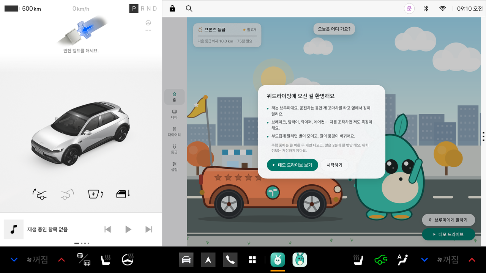 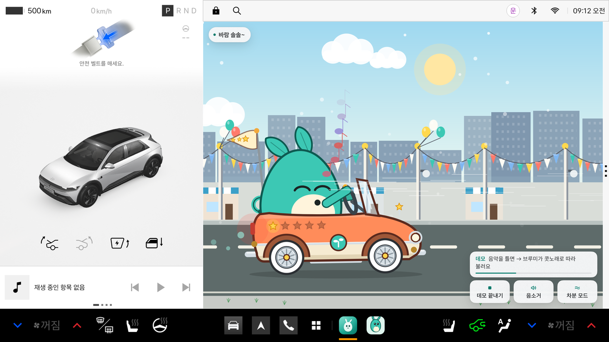

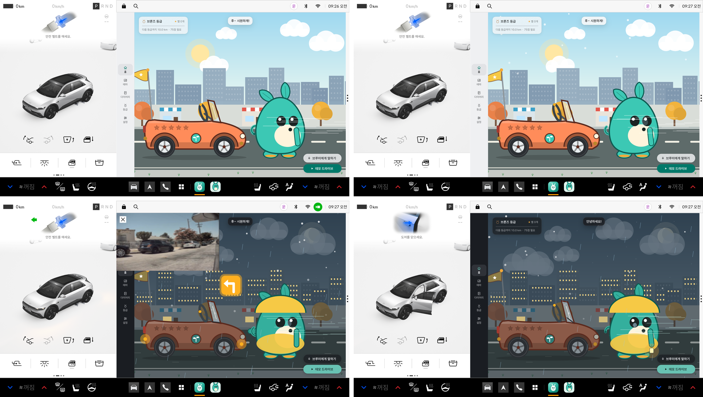

### 성능

목표 60fps. 그리기 루프에서 객체를 새로 만들지 않도록 경로·입자를 재사용하고, 움직이지 않는 부분은 한 번만 비트맵으로 그려 둡니다. 외부 이미지·폰트·효과음 파일이 없어 APK는 약 20MB입니다(소리는 모두 합성).

### 일정

| 기간 | 한 일 / 할 일 |
|---|---|
| ~11/05 | 프로젝트 골격, 시뮬레이터, 캐릭터와 꼬마차, 시계·엔진룸 테마 (완료) |
| ~11/09 | Pleos SDK 5종 연동, 테마 팩, 인터페이스와 테마 전환 (완료) |
| ~11/12 | 안전운전 등급과 단계, 색상·소품, 테마별 데모와 직접 조작 (완료) |
| ~11/14 | 음악 반응, 에뮬레이터 확인, release APK, 시연 영상, 제출 (완료) |
| 11/23 ~ 12/02 (1차 합격 시) | 실제 신호로 다듬기, 성능 튜닝, PT 자료와 라이브 시연 준비 |
| 12/19 ~ 2027.01 (최종 선정 시) | 새 기능 없이 안정화, 전시 영상, 현장 시연용 최종 APK |

### 제출 시점 현황

- [x] 서명된 release APK (`apk/Kyle_WithDriving_release.apk`, 약 20MB, v1.7.0-contest)
- [x] 자동 테스트 876개 통과
- [x] Pleos Connect Emulator v2.1.0에서 release APK 실행 확인: 첫 실행, 하이라이트 데모, 테마 전환, 음악 반응
- [x] 시연 영상
- [x] GitHub 저장소 (소스 + APK + README)
- [x] Virtual Console로 Vehicle SDK 실제 콜백 확인 (release APK): 풍량·온도·전조등·와이퍼·방향지시등·문·기어
- [ ] 실차 확인, App Market을 통한 주행 중 표시 확인 (공모전 범위 밖)

---

## 6. 기대효과 및 발전 가능성

### 사용자에게 주는 가치

- **정서적 동반감**: 혼자 운전해도 같이 달리는 세계가 있다는 느낌.
- **지루함과 스트레스 감소**: 정체·빗길·충전 대기 같은 지루한 순간이 작은 장면이 됩니다.
- **자연스러운 안전운전 동기**: 부드럽게 운전할수록 등급이 오르고 테마가 자랍니다. 잔소리 대신 보상입니다.

### 타깃 고객 분석

| 구분 | 고객 | 필요 | 위드라이빙을 쓰는 이유 |
|---|---|---|---|
| 1차 | 20~40대 혼자 출퇴근하는 운전자 | 반복되는 출퇴근의 지루함 | 아무것도 안 해도 반응해 주는 화면, 매일 쌓이는 등급 |
| 2차 | 어린 자녀를 둔 가족 | 장거리 이동 중 아이의 지루함 | 차 기능이 캐릭터 이야기가 되어 아이가 즐거워함 |
| 3차 | 자동차·시계 같은 기계를 좋아하는 운전자, EV 오너 | 내 차에 대한 애착, 충전 대기 시간 | 내 차가 움직이는 시계와 엔진 단면, 수집하는 단계와 색상 |

### 예상 MAU (가정에 기반한 추정)

공개된 Pleos Connect 탑재 차량 수가 없어, **아래 입력값은 모두 팀의 가정**입니다. 공식 수치가 나오면 바꿔 넣습니다.

MAU = (Pleos Connect 탑재 운행 차량 수) × (App Market 방문 비율) × (설치율) × (월간 활성 비율)

| 시나리오 | 탑재 차량 (가정) | Market 방문 (가정) | 설치율 (가정) | 월간 활성 (가정) | 예상 MAU |
|---|---|---|---|---|---|
| 보수 | 100,000대 | 30% | 3% | 40% | 약 360명 |
| 기본 | 300,000대 | 40% | 5% | 55% | 약 3,300명 |
| 낙관 | 500,000대 | 50% | 8% | 65% | 약 13,000명 |

월간 활성 비율을 높게 잡은 이유: 위드라이빙은 **차를 탈 때마다 다시 만나는 앱**이라, 사용자가 일부러 열 이유를 찾지 않아도 됩니다. 차를 타는 날이 곧 사용하는 날입니다.

### 리텐션 목표

**목표 D30 리텐션 40%** (측정값이 아닌 목표치). 근거가 되는 장치:

- 매 주행이 곧 사용 계기 (차 자체가 알림 역할)
- 안전운전 등급: "오늘도 부드럽게 달리면 다음 단계가 열린다"는 이유를 매일 줌 (10 · 30 · 60 · 100km)
- 테마 12개 × 5단계, 색상 55종, 소품 33개, 친구 15종이라는 넉넉한 수집 요소
- 유리병 정원의 성장, 로봇 조립처럼 다음 주행에도 이어지는 진행
- 잔소리하지 않는 톤, 주행 중 2분에 한 마디만 말하는 절제 → 거슬려서 지우는 일을 줄임

### 향후 서비스 확대

1. **테마·시즌 콘텐츠**: 새 테마, 계절 색상과 소품, 오르골 곡, 로봇 기체를 유료 아이템으로 제공. 구조상 새 테마는 그리기 코드만 더하면 됩니다.
2. **프리미엄 팩**: 시계 테마의 마감과 문자판, 엔진룸 테마의 V6·하이브리드·듀얼 모터 단면도.
3. **브랜드 협업**: 실제 시계·자동차 브랜드, 캐릭터 IP와의 협업은 **정식 라이선스 계약을 맺은 뒤에만** 진행합니다(현재 출품작에는 어떤 브랜드 요소도 없음). 현대·기아·제네시스 브랜드 분위기에 맞춘 전용 테마.
4. **키즈 에디션**: 뒷좌석 화면용 콘텐츠(주차 중 또는 동승자 화면 전용).
5. **플릿·배달 기사 에디션**: 장시간 운전자를 위한 휴식 알림과 부드러운 운전 리포트.
6. **보험 연계 (동의 기반)**: 사용자가 명시적으로 동의한 경우에만 안전 거리와 안전 점수 요약을 운전 습관 연계 보험(UBI)에 제공.
7. **다국어**: Pleos 해외 시장용 영어·일본어 등 대사 팩.
8. **캐릭터 굿즈**: 방향제, 키링, 차량용 인형 등 차 밖으로 넓어지는 브루미.

### 심사 기준별 요약

| 심사 기준 | 이 앱의 답 | 기획서 위치 |
|---|---|---|
| **차량특화성** | 운전 조작 자체가 입력(페달·공조·깜빡이·와이퍼·기어·충전). 주행·정차·주차·충전 맥락별 화면. 주행 중에는 버튼 2개만 | 3-①~③, 3-⑨, 4 |
| **창의성** | 같은 운전이 열두 가지 세계가 됨(차가 태엽을 감는 시계, 내 차로 도는 엔진 단면, 거리만큼 조립되는 로봇). 꾸중 없는 안전운전 보상 | 2, 3-③~⑤ |
| **기술활용성** | Pleos SDK 5종 전부 사용. 차속 API 부재를 FusedLocation으로 해결. 신호 누락 대응. 자동 테스트 876개 | 5 |
| **사업성** | 가정을 밝힌 MAU 산식, 차를 탈 때마다 다시 만나는 구조, 등급 기반 리텐션, 테마·프리미엄·브랜드·보험 확장 | 6 |

---

## 7. 참고자료 (선택 · 가산점)

- **시연 영상**: 첨부 파일 `WithDriving_시연영상.mp4` (Pleos Connect Emulator에서 release APK를 실행해 녹화). 같은 파일이 저장소 `docs/media/demo.mp4`에 있습니다.
- **GitHub 저장소**: 주소와 최종 커밋 번호는 접수 메일에 적었습니다. 소스 전체, README(실행 방법·테스트 환경), 테스트가 들어 있습니다.
- **APK**: 저장소 `apk/Kyle_WithDriving_release.apk` (실행 가능한 release 빌드)
- **화면 자료**: 저장소 `docs/screenshots/`(552장, 에뮬레이터에서 찍은 화면 3장 포함), 주행 GIF `docs/media/`
- **근거 자료**: 시나리오 상태 로그(`docs/scenario-logs/`), 퍼미션 표(`docs/permissions.md`), 캐릭터 독창성 검토(`docs/character-originality.md`), 오픈소스 고지(`THIRD_PARTY_NOTICES.md`)

---

## 8. 숏폼 링크 (선택 · 가산점 없음)

해당 없음
